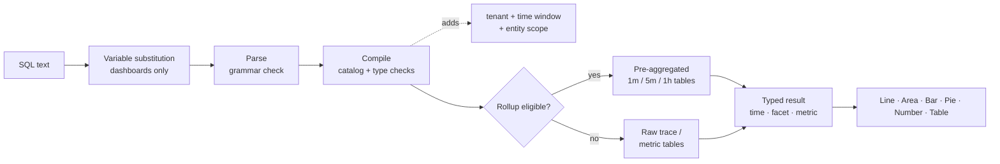

## Come eseguire query con SQL: la meccanica dell&#39;esecuzione di query {#how-to-query-with-sql-the-mechanics-of-querying}

Prima di usare uno strumento, è utile conoscerne il funzionamento. Questo documento illustra come esplorare i dati, spiega cosa accade quando viene eseguita una query e illustra query di esempio da semplici a complesse.

### Esplorazione dei dati

Il modo migliore per utilizzare SQL consiste nell&#39;aprire **Esplora** e provarlo con i propri dati.

&#x200B;> [!TIP]
> SQL è di sola lettura. Non può modificare o eliminare dati e ogni query ha l’ambito del tuo tenant.

1. **Selezionare un cliente** nel commutatore tenant nella parte superiore dell&#39;app. SQL necessita di un singolo tenant.
2. Apri **Esplora**. La scheda **Generatore di immagini** consente di scegliere **Da** (un&#39;entità), **Aggregato**, **Filtri**, **Facet** e **Serie temporali**. L&#39;istruzione SQL generata viene visualizzata sotto.
3. Passa alla scheda **SQL** per modificare direttamente la query. L&#39;editor completa automaticamente entità, attributi e funzioni durante la digitazione.
4. Apri il pannello **Guida query** a destra per sfogliare entità, tipi di attributi e query di esempio. Fai clic su un esempio per caricarlo.
5. Fai clic su **Convalida** per verificare una query senza eseguirla oppure su **Esegui** (⌘/Ctrl + Invio) per visualizzare i risultati.

Per iniziare, digita `FROM` e scegli un&#39;entità, quindi aggiungi `SELECT` e un attributo:

```sql
FROM Transaction SELECT name, duration LIMIT 20
```

Questa è una **query evento** di base. Restituisce 20 richieste in entrata, mostrando il nome dell’operazione e la durata di ciascuna.

Ora sostituisci gli attributi con un **aggregato** e raggruppa il risultato:

```sql
FROM Transaction SELECT count(*) FACET service
```

In questo modo vengono conteggiate le richieste per servizio, il che mostra quali servizi stanno generando rapporti.

&#x200B;> [!IMPORTANT]
> **Individua prima della compilazione.** La disponibilità degli attributi dipende dalla strumentazione di ciascun servizio. Eseguire le [query di individuazione](#101-data-discovery) su un nuovo tenant per vedere quali servizi, host, attributi e metriche contengono effettivamente i dati.

### Esecuzione di una query

Quando esegui una query, Observability Insights:

1. **Sostituisce le variabili**, sostituendo `{{name}}` token con la selezione della variabile del dashboard corrente. Questo accade nel browser, solo sulle dashboard.
2. **Analizza** il testo. Qualsiasi elemento non compreso nella grammatica SQL viene rifiutato, inclusi punti e virgola, funzioni SQL non elaborate e sottoquery.
3. **Compila** la query. Viene eseguito il mapping di ogni attributo logico, ad esempio `urlPath`, alla relativa espressione memorizzata e vengono convalidati tipi e funzioni.
4. **Aggiunge guardie obbligatorie**: il tenant, l&#39;intervallo di tempo e l&#39;ambito fisso dell&#39;entità (ad esempio, `Transaction` indica solo l&#39;estensione del server).
5. **Indirizza** query di serie temporali idonee a **aggregare** tabelle. Questa operazione è automatica e i risultati corrispondono ai dati non elaborati.
6. **Esegue** la query con un timeout di 15 secondi e un budget di lettura byte, quindi restituisce le colonne digitate (tempo, facet, metrica) riprodotte dall&#39;interfaccia utente.



### Forme risultato

Ogni query restituisce una delle quattro forme. La forma determina quali grafici hanno senso.

| Forma | Come si ottiene | `LIMIT` predefinito | Visualizzazione migliore |
| --------------- | ---------------------------------------------------- | --------------- | ------------------ |
| **Affissioni** | Solo aggregati, senza `FACET` e senza `TIMESERIES` | 1 | Numero |
| **Facet** | Aggregati + `FACET` | 10 | Barra, Torta, Tabella |
| **Serie temporali** | Aggregati + `TIMESERIES` (con o senza `FACET`) | 5.000 righe | Linea, area, barra |
| **Eventi** | Solo attributi non elaborati | 100 | Tabella |

<a id="time-window-precedence"></a>

### Precedenza finestra temporale

| Dove viene eseguita la query | Quale finestra si applica |
| --------------------------------- | ---------------------------------------------------------------------------------- |
| **Widget dashboard** | Il selettore ore **del dashboard**. `SINCE`/`UNTIL` nella query ignorati. |
| **Aggiungi anteprima widget** | Selettore ora nella finestra di dialogo **Aggiungi widget**. |
| **Esplora** | Selettore temporale globale. `SINCE`/`UNTIL` vengono ignorati quando è attivo un intervallo del selettore. |
| **API senza intervallo esplicito** | `SINCE`/`UNTIL` nella query, impostazione predefinita: ultima ora. |

&#x200B;> [!NOTE]
> Poiché il selettore è vincente nei dashboard e in Esplora, questa guida in genere esclude `SINCE` dalle query del dashboard. È sempre necessario definire un selettore ora per le query.
