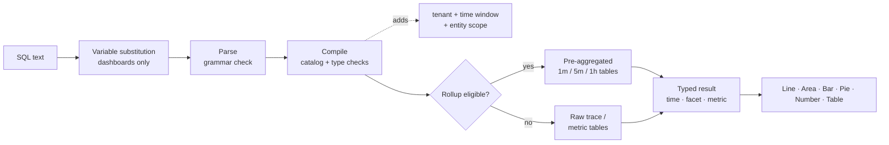

<a id="top"></a>

# Documentazione di Adobe Observability Insights Dashboard/Query

**Linguaggio query di Adobe Observability Insights (SQL)**: consente di eseguire query, grafici e dashboard della telemetria in Adobe Observability Insights.

|                |                                                                  |
| -------------- | ---------------------------------------------------------------- |
| **Si applica a** | Interfaccia utente approfondimenti → **Esplora** e **Dashboard** (dashboard personalizzati) |
| **Pubblico** | Ingegneri, SRE e utenti esperti che conoscono SQL |

>[!TIP]
> Ogni blocco di codice contrassegnato `sql` è una query SQL che è possibile incollare direttamente in **Esplora → SQL** o in **Dashboard → Aggiungi widget → SQL**.

## Mappa della documentazione

| Sezione | Doc | Che cosa imparerai |
| --------------- | ----------------------------------------------------------------------------------- | ------------------------------------------------------------------------------------------- |
| **Introduzione** | [1. Introduzione a SQL](#1-get-started-with-SQL-the-language-of-your-telemetry) | Che cos&#39;è SQL, cosa si può chiedere, dove usarlo, le regole di base |
|                 | [2. Eseguire query con SQL](#2-how-to-query-with-SQL-the-mechanics-of-querying) | Come esplorare i dati, come viene eseguita una query, esempi funzionanti |
|                 | [3. Grafici e dashboard](#3-charts-and-dashboards-visualizing-your-data) | Come trasformare le query in grafici e creare dashboard passo dopo passo |
| **Riferimento** | [4. Riferimento SQL](#4-SQL-reference) | Ogni clausola, funzione e operatore, con esempi |
|                 | [5. Dizionario dati](#5-data-dictionary) | Ogni entità e attributo che è possibile interrogare |
| **Esercitazioni** | [6. Esercitazione 1: Le prime query](#6-tutorial-1-your-first-queries) | `SELECT`, `FROM`, `LIMIT`, aggregati, ora, `TIMESERIES`, `WHERE`, `FACET` |
|                 | [7. Esercitazione 2: Controllare i dati](#7-tutorial-2-control-your-data) | Valori univoci, più recente/meno recente, percentuali, percentili, etichette, caratteri jolly, ordinamento |
|                 | [8. Esercitazione 3: Avanzare il dashboard](#8-tutorial-3-advance-your-dashboarding) | Aggregati condizionali, Apdex, tassi, istogrammi, formule, variabili, sezioni |
|                 | [9. Esercitazione 4: Funzioni avanzate](#9-tutorial-4-advanced-functions) | `stddev`, `derivative`, classificati `latest`, quota del totale, composizione dell&#39;estensione, individuazione metrica |
| **Esempi** | [10. Query manuale](#10-query-cookbook) | Oltre 100 query pronte all’uso per argomento (incluso AEM) |
|                 | [11. Progetti dashboard](#11-dashboard-blueprints) | Dieci dashboard complete e complesse con query di ogni widget |
| **Operazione** | [12. Prestazioni](#12-performance) | Aggregazioni dati, preventivi per le query e procedure rapide per mantenere i dashboard |
|                 | [13. Risoluzione dei problemi](#13-troubleshooting) | Ogni messaggio di errore, cosa significa e come correggerlo |
|                 | [14. Appendice](#14-appendix) | Limiti, formato del file di esportazione, foglio di riferimento di una pagina |

# Introduzione

## &#x200B;1. Introduzione a SQL: lingua della telemetria

SQL è un linguaggio di query simile a SQL per i dati di Observability Insights. È la stessa lingua dietro ogni widget del dashboard personalizzato e la pagina **Esplora**, in modo da poter creare le visualizzazioni necessarie al team.

SQL funziona con **entità**, che sono viste logiche intuitive come `Transaction`, `Span` o `CpuUtilization`. Non è mai possibile eseguire query dirette sulle tabelle di archiviazione. Observability Insights compila ogni query SQL in una query warehouse sicura con parametri. La query viene sempre eseguita nel tenant e nell&#39;intervallo di tempo selezionato.

```sql
SELECT count(*) AS requests FROM Transaction TIMESERIES AUTO
```

### Operazioni possibili con SQL

Usa SQL per:

- **Genera grafici** di velocità effettiva, frequenza di errori, latenza, approssimativa, CPU, memoria, heap JVM, disco e rete nel tempo.
- **Rispondere a domande specifiche**, ad esempio &quot;quali percorsi URL sul livello di pubblicazione hanno il peggiore p95?&quot; o &quot;quale dominio a valle ha esito negativo?&quot;
- **Analizzare gli incidenti** eseguendo l&#39;espansione da un indicatore KPI a singole richieste e ID di traccia.
- **Crea dashboard** con KPI, tendenze, tabelle, formule, note, intestazioni di sezione e variabili.
- **Profilo dei carichi di lavoro di AEM** (Adobe Experience Manager) utilizzando gli attributi Sling, JSP, JCR, Dispatcher e GraphQL.

SQL supporta sia **query evento**, che restituiscono singole righe di richiesta, sia **query aggregate**, che restituiscono totali, percentili, percentuali, raggruppamenti e serie temporali.

>[!TIP]
> I modelli in **Dashboard → Crea dashboard** sono interamente generati da SQL. Apri qualsiasi widget modello con l’icona a forma di matita per visualizzare la query corrispondente e imparare da essa.

### Elementi su cui è possibile eseguire query

SQL può eseguire query su quattro famiglie di dati. L&#39;elenco completo si trova nel [dizionario dati](#5-data-dictionary).

| Famiglia | Entità | Domande tipiche |
| ------------------------------------ | ------------------------------------------------------------------------------------------------------------------------------------------------------------------ | -------------------------------------------------------------------- |
| **Tracce (APM)** | `Transaction` (richieste in entrata), `AppRequest` (richieste + consumer di messaggi), `Span` (ogni intervallo) | Throughput, latenza, errori, Apdex, chiamate downstream, percorsi del codice AEM |
| **Metriche host e runtime curate** | `CpuUtilization`, `MemoryUtilization`, `LoadAverage5m`, `DiskUtilization`, `NetworkReceiveRate`, `JvmHeapUsed`, `JvmThreadCount`, `DispatcherRequestRate` e altri | Saturazione, capacità, stato JVM, carico del dispatcher |
| **Metriche generiche** | `MetricGauge`, `MetricSum` | Qualsiasi metrica OpenTelemetry per nome, individuazione metrica |
| **Composizione span preaggregata** | `SpanBreakdown` | Quali operazioni figlio costituiscono una transazione |

>[!NOTE]
> I registri, le definizioni degli avvisi e le relazioni di inventario non sono disponibili.

### Dove utilizzare SQL

| Dove | Come aprirlo | A cosa serve |
| ----------------------- | ------------------------------------------------------------------------------ | ------------------------------------------------------------------------------------------------------------------------------------------------------------------------------------ |
| **Esplora** | Navigazione a sinistra → **Esplora** | Analisi ad hoc. Utilizza **Visual Builder** o la scheda **SQL**, **Convalida**, quindi **Esegui** (⌘/Ctrl + Invio). Include **Cronologia** e **query salvate** e un pannello **Guida query**. |
| **Dashboard** | Il → di navigazione sinistro **Dashboard** → aprire o creare un dashboard → **Aggiungi widget** | Grafici, KPI e tabelle persistenti, combinati in dashboard. |
| **Widget formula** | **Aggiungi widget → Formula** | Combina 2-6 query SQL con dati aritmetici (rapporti, spazio di crescita, velocità di masterizzazione). |
| **Variabili del dashboard** | **+ Variabile → da una query** | Compilare un selettore dai valori distinti di una query SQL `FACET`. |
| **Verifica query** | Passare il puntatore del mouse su un grafico → controllare la query | Visualizzare l&#39;istruzione SQL sottostante un grafico integrato o dashboard. |

### Struttura query SQL

SQL segue una sintassi basata su una clausola. Questa query conta tutte le richieste in entrata nella finestra selezionata:

```sql
SELECT count(*) FROM Transaction
```

Di seguito sono elencate tutte le clausole disponibili:

```text
SELECT  function(attribute) [FILTER (WHERE condition)] [AS alias] [, ...]
        | attribute [AS alias] [, ...]
FROM    Entity
  [WHERE      condition [AND | OR ...]]
  [FACET      attribute [, attribute ...]]        -- up to 5
  [SINCE      n unit [AGO]]
  [UNTIL      NOW | n unit [AGO]]
  [TIMESERIES AUTO | MAX | n unit]
  [ORDER BY   alias [ASC | DESC]]
  [LIMIT      number]                              -- 1 to 5000
```

Di seguito sono riportate le regole SQL seguenti:

| Regola | Dettagli |
| ---------------------------- | ------------------------------------------------------------------------------------------------------------------------------------------------------------------------------------ |
| **Clausole obbligatorie** | `SELECT` e `FROM` sono obbligatori. Ogni altra clausola è facoltativa. È possibile iniziare con: `FROM Transaction SELECT count(*)` è valido anche. |
| **Ordine clausole** | Le clausole successive a `FROM` possono essere visualizzate in qualsiasi ordine. Ogni clausola può essere visualizzata una sola volta. |
| **Dimensione query** | Una query non può superare i 4 KB. |
| **Distinzione maiuscole/minuscole** | Parole chiave, nomi di funzioni, nomi di entità e nomi di attributi sono **senza** distinzione tra maiuscole e minuscole. I valori stringa **sono** con distinzione tra maiuscole e minuscole (`'Error'` ≠ `'error'`). |
| **Stringhe** | Usa virgolette singole: `WHERE status = 'Error'`. Per includere un preventivo, raddoppiarlo: `'O''Brien'`. Le virgolette doppie non sono accettate. |
| **Valori letterali** | Stringhe, numeri (inclusi negativi e decimali), `TRUE`, `FALSE`, `NULL`. |
| **Nomi di attributo** | I nomi possono contenere lettere, cifre, `_` e `.` (ad esempio `http.statusCode`). Non sono necessari backtick. |
| **Aggregati e attributi** | Una query seleziona attributi non elaborati (un elenco di eventi) o aggrega, mai entrambi. Per raggruppare, utilizzare `FACET`. |
| **Intervallo temporale** | L&#39;impostazione predefinita è l&#39;ultima ora. Il massimo è di 31 giorni. Nei dashboard e in Esplora, il **selettore ore** imposta la finestra (vedi [Finestra temporale](#time-window-precedence)). |
| **Non supportato** | Punti e virgola, commenti, sottoquery, join, `SELECT *`, corrispondenza tra gli attributi in `SELECT`, `HAVING`, `COMPARE WITH`. Per informazioni sulle alternative, vedere [Funzionalità non disponibili in SQL](#what-SQL-doesnt-do). |

### Passaggi successivi

- [Eseguire query con SQL](#2-how-to-query-with-SQL-the-mechanics-of-querying): esplorare i dati e capire come vengono eseguite le query.
- [Grafici e dashboard](#3-charts-and-dashboards-visualizing-your-data): visualizza i risultati.
- [Esercitazione 1: Le prime query](#6-tutorial-1-your-first-queries): una procedura dettagliata.
- [Riferimento SQL](#4-SQL-reference): sintassi completa, clausole e funzioni.

[↑ Torna all&#39;inizio](#top)

## &#x200B;2. Come eseguire query con SQL: la meccanica dell&#39;esecuzione di query

Prima di usare uno strumento, è utile conoscerne il funzionamento. Questo documento illustra come esplorare i dati, spiega cosa accade quando viene eseguita una query e illustra query di esempio da semplici a complesse.

### Esplorazione dei dati

Il modo migliore per utilizzare SQL consiste nell&#39;aprire **Esplora** e provarlo con i propri dati.

>[!TIP]
> SQL è di sola lettura. Non può modificare o eliminare dati e ogni query ha l’ambito del tuo tenant.

1. **Selezionare un cliente** nel commutatore tenant nella parte superiore dell&#39;app. SQL necessita di un singolo tenant.
2. Apri **Esplora**. La scheda **Generatore di immagini** consente di scegliere **Da** (un&#39;entità), **Aggregato**, **Filtri**, **Facet** e **Serie temporali**. L&#39;istruzione SQL generata viene visualizzata sotto.
3. Passa alla scheda **SQL** per modificare direttamente la query. L&#39;editor completa automaticamente entità, attributi e funzioni durante la digitazione.
4. Apri il pannello **Guida query** a destra per sfogliare entità, tipi di attributi e query di esempio. Fai clic su un esempio per caricarlo.
5. Fai clic su **Convalida** per verificare una query senza eseguirla oppure su **Esegui** (⌘/Ctrl + Invio) per visualizzare i risultati.

Per iniziare, digita `FROM` e scegli un&#39;entità, quindi aggiungi `SELECT` e un attributo:

```sql
FROM Transaction SELECT name, duration LIMIT 20
```

Questa è una **query evento** di base. Restituisce 20 richieste in entrata, mostrando il nome dell’operazione e la durata di ciascuna.

Ora sostituisci gli attributi con un **aggregato** e raggruppa il risultato:

```sql
FROM Transaction SELECT count(*) FACET service
```

In questo modo vengono conteggiate le richieste per servizio, il che mostra quali servizi stanno generando rapporti.

>[!IMPORTANT]
> **Individua prima della compilazione.** La disponibilità degli attributi dipende dalla strumentazione di ciascun servizio. Eseguire le [query di individuazione](#101-data-discovery) su un nuovo tenant per vedere quali servizi, host, attributi e metriche contengono effettivamente i dati.

### Esecuzione di una query

Quando esegui una query, Observability Insights:

1. **Sostituisce le variabili**, sostituendo `{{name}}` token con la selezione della variabile del dashboard corrente. Questo accade nel browser, solo sulle dashboard.
2. **Analizza** il testo. Qualsiasi elemento non compreso nella grammatica SQL viene rifiutato, inclusi punti e virgola, funzioni SQL non elaborate e sottoquery.
3. **Compila** la query. Viene eseguito il mapping di ogni attributo logico, ad esempio `urlPath`, alla relativa espressione memorizzata e vengono convalidati tipi e funzioni.
4. **Aggiunge guardie obbligatorie**: il tenant, l&#39;intervallo di tempo e l&#39;ambito fisso dell&#39;entità (ad esempio, `Transaction` indica solo l&#39;estensione del server).
5. **Indirizza** query di serie temporali idonee a **aggregare** tabelle. Questa operazione è automatica e i risultati corrispondono ai dati non elaborati.
6. **Esegue** la query con un timeout di 15 secondi e un budget di lettura byte, quindi restituisce le colonne digitate (tempo, facet, metrica) riprodotte dall&#39;interfaccia utente.



### Forme risultato

Ogni query restituisce una delle quattro forme. La forma determina quali grafici hanno senso.

| Forma | Come si ottiene | `LIMIT` predefinito | Visualizzazione migliore |
| --------------- | ---------------------------------------------------- | --------------- | ------------------ |
| **Affissioni** | Solo aggregati, senza `FACET` e senza `TIMESERIES` | 1 | Numero |
| **Facet** | Aggregati + `FACET` | 10 | Barra, Torta, Tabella |
| **Serie temporali** | Aggregati + `TIMESERIES` (con o senza `FACET`) | 5.000 righe | Linea, area, barra |
| **Eventi** | Solo attributi non elaborati | 100 | Tabella |

<a id="time-window-precedence"></a>

### Precedenza finestra temporale

| Dove viene eseguita la query | Quale finestra si applica |
| --------------------------------- | ---------------------------------------------------------------------------------- |
| **Widget dashboard** | Il selettore ore **del dashboard**. `SINCE`/`UNTIL` nella query ignorati. |
| **Aggiungi anteprima widget** | Selettore ora nella finestra di dialogo **Aggiungi widget**. |
| **Esplora** | Selettore temporale globale. `SINCE`/`UNTIL` vengono ignorati quando è attivo un intervallo del selettore. |
| **API senza intervallo esplicito** | `SINCE`/`UNTIL` nella query, impostazione predefinita: ultima ora. |

>[!NOTE]
> Poiché il selettore è vincente nei dashboard e in Esplora, questa guida in genere esclude `SINCE` dalle query del dashboard. È sempre necessario definire un selettore ora per le query.

### Esempi di query SQL

Ecco un esempio più completo. Per questa query:

- Si sceglie `Transaction` come entità.
- Utilizzare `SELECT` per calcolare la durata del 95° percentile.
- I risultati vengono raggruppati per servizio con `FACET`.
- Si utilizza `TIMESERIES AUTO` per tracciare i dati in un intervallo ridimensionato automaticamente.

```sql
FROM Transaction SELECT percentile(duration, 95) AS p95 FACET service TIMESERIES AUTO
```

In un grafico a linee viene generata una riga per servizio, con i 10 servizi più attivi visualizzati per impostazione predefinita.

Fai clic su ogni esempio di seguito per espanderlo.

<details>
<summary><strong>Query di base delle richieste in entrata</strong></summary>

Tempo medio di risposta, in millisecondi, di tutte le richieste in entrata:

```sql
SELECT average(duration) FROM Transaction
```

</details>

<details>
<summary><strong>Nomi di attributi contenenti punti</strong></summary>

I nomi punteggiati non richiedono virgolette:

```sql
SELECT count(*) FROM Transaction WHERE http.statusCode >= 500 FACET http.route
```

</details>

<details>
<summary><strong>La query restituisce più colonne</strong></summary>

Diversi aggregati in una query diventano colonne in una tabella:

```sql
SELECT count(*) AS requests, average(duration) AS avgMs, percentile(duration, 95) AS p95, max(duration) AS maxMs FROM Transaction FACET service
```

</details>

<details>
<summary><strong>Aggregazioni condizionali in un passaggio</strong></summary>

Totale, errori e 5xx affiancati:

```sql
SELECT count(*) AS total, count(*) FILTER (WHERE status = 'Error') AS errors, count(*) FILTER (WHERE http.statusCode >= 500) AS http5xx FROM Transaction FACET service
```

</details>

<details>
<summary><strong>Query di una metrica curata</strong></summary>

Media di CPU per host nel tempo:

```sql
SELECT average(value) AS cpu FROM CpuUtilization FACET host TIMESERIES AUTO
```

</details>

<details>
<summary><strong>Query di qualsiasi metrica OpenTelemetry per nome</strong></summary>

Usa `MetricGauge` / `MetricSum` per le metriche senza un&#39;entità curata:

```sql
SELECT latest(value) AS bytesUsed FROM MetricSum WHERE metric = 'jvm.memory.used' FACET host, pool
```

</details>

<a id="what-SQL-doesnt-do"></a>

### Quali sono le operazioni non eseguite da SQL

SQL è volutamente piccolo. In questo modo le query sono sicure, veloci e isolate dal tenant. Se hai bisogno di una di queste funzionalità, utilizza l’alternativa.

| Funzionalità | Stato | Alternativa |
| ------------------------------------------- | ------------- | ------------------------------------------------------------------------------------------------------------ |
| `SELECT *` | Non supportato | Elencare gli attributi desiderati: `SELECT timestamp, name, duration, traceId …`. |
| Combinazione di attributi raw e aggregati | Non supportato | Utilizza `FACET attr` o `latest(attr)` / `earliest(attr)`. |
| Matematica in `SELECT` (`a - b`, `count(*) / 60`) | Non supportato | Widget **Formula** (dashboard). |
| Join e sottoquery | Non supportato | **Widget Formula** o due widget affiancati. |
| `HAVING` | Non supportato | `ORDER BY alias` + `LIMIT`. |
| `COMPARE WITH` | Non supportato | Modificate il selettore dell&#39;ora o posizionate due widget su schede diverse. |
| `FACET CASES` | Non supportato | Una colonna `count(*) FILTER (WHERE …)` per ogni caso (vedere [Esercitazione 3](#83-group-values-into-cases-with-filter)). |
| `histogram()` | Non supportato | `FILTER` colonne con bucket (vedi [Esercitazione 3](#84-build-a-latency-histogram)). |
| `uniques()` / `keyset()` | Non supportato | `FACET attr LIMIT n` elenca valori distinti. Le query di individuazione elencano le metriche e gli attributi compilati. |
| `RLIKE` (regex) | Non supportato | `LIKE` / `NOT LIKE` con `%` e `_` caratteri jolly o `IN (…)`. |
| Commenti (`--`, `//`, `/* */`) | Non supportato | Inserisci le note nel titolo del widget o in un widget **Testo**. |
| Date assolute in `SINCE` | Non supportato | Utilizza l’intervallo assoluto del selettore del tempo. |
| Conversione tipo (`numeric()`, `string()`) | Non necessario | Gli attributi vengono digitati nel catalogo. |

[↑ Torna all&#39;inizio](#top)

## &#x200B;3. Grafici e dashboard: visualizzazione dei dati

Le query consentono di trovare le informazioni necessarie. Grafici e dashboard rendono tali informazioni utili per la tua organizzazione. In questo documento viene illustrato come i risultati SQL diventano grafici e come creare, organizzare e condividere dashboard.

### Grafici

È possibile eseguire il rendering di ogni risultato SQL come uno dei sei tipi di grafico.

| Tipo di grafico | Utilizza per | Forma Query |
| --------------- | --------------------------------------------------- | ----------------------------------------------- |
| **Riga** | Tendenze nel tempo; una riga per valore di sfaccettatura | Aggregato + `TIMESERIES` |
| **Area** | Volume nel tempo, ad esempio throughput per servizio | Aggregato + `TIMESERIES` |
| **Barra** | Confronto di categorie; serie temporali sparse | Aggregato + `FACET` (± `TIMESERIES`) |
| **Torta/Anello** | Quota di un intero (combinazione di codici di stato, traffico per livello) | Un aggregato + `FACET`, pochi valori |
| **Numero** | Un singolo KPI, con soglie colore opzionali | Affissioni (solo aggregati) |
| **Tabella** | Più aggregati per gruppo o elenchi di eventi | Diversi aggregati + `FACET` o attributi non elaborati |

Dopo che un widget è su una dashboard puoi:

- **Modifica** la query, il titolo, il tipo di grafico e l&#39;unità (icona a forma di matita).
- **Duplica** per creare una variante, ad esempio lo stesso grafico per un altro livello.
- **Scarica CSV** delle righe correnti o **PNG** alla risoluzione 2×.
- **Trascinalo** per la maniglia di presa e **ridimensionalo** dall&#39;angolo in basso a destra.

### Dashboard

I grafici funzionano bene da soli, ma i dashboard li uniscono. Un dashboard è un insieme denominato con ambito tenant di **tabs**. Ogni scheda è una griglia a 12 colonne di **widget**.

| Concetto | Significato |
| --------------- | ------------------------------------------------------------------------------------------------------------------------------- |
| **Dashboard** | Una raccolta denominata di 1-40 schede, memorizzata lato server per il tenant selezionato. |
| **Scheda** | Una griglia di widget (fino a 200). Rinominalo con la matita, eliminalo con ×, aggiungine uno con **+**. Deve rimanere almeno una scheda. |
| **Widget** | Una **query singola**, una **formula** o **testo** (una nota o un&#39;intestazione di sezione comprimibile). |
| **Variabile** | Selezione sopra la griglia. Il valore viene inserito come `{{name}}`. |
| **Selettore ora** | Finestra per ogni widget nel dashboard. |

### Creare un dashboard, passo dopo passo

#### Passaggio 1: prima di iniziare

- **Selezionare un singolo cliente** nel commutatore tenant. **Crea dashboard** è disabilitato mentre **Sono selezionati tutti gli account**. Impossibile eseguire SQL con il tenant demo.
- **Ruoli.** Chiunque abbia accesso al dashboard può aggiungere, modificare e salvare widget. La creazione o la modifica di **variabili** e l&#39;analisi della query di un widget sono limitate a **amministratori organizzazione** e **amministratori privilegiati**.

#### Passaggio 2: creare il dashboard

1. Apri **Dashboard** nel menu di navigazione a sinistra.
2. Fai clic su **Crea dashboard**.
3. Scegli un punto di partenza:

   | Opzione | I risultati ottenuti |
   | ---------------------------- | -------------------------------------------------------------------------------------------------------- |
   | **Creare un dashboard personalizzato** | Un dashboard vuoto con una scheda. |
   | **Nozioni di base su CPU** | CPU host e di processo (user/system/iowait/steal), throughput, carico, circa |
   | **Panoramica all-in-one** | KPI (volume, % errore, Apdex, p95), errori/problemi di traffico, tabelle CPU/memoria, thread JVM, operazioni lente. |
   | **Prime transazioni** | Apdex, p95 per operazione, carico per host/CPU, transazioni più lente con ID di traccia, suddivisione degli errori HTTP. |

4. Immetti un **nome** e conferma. Viene visualizzata l’area di lavoro del dashboard.

#### Passaggio 3: conoscere l’area di lavoro

| Area | Controlli |
| ---------------------------- | --------------------------------------------------------------------------------------------------------- |
| **Barra superiore** | **Aggiungi widget**, **Guida** (foglio di riferimento rapido in-app), **Importa**, **Esporta**, **Salva**, selezione ora e aggiorna |
| **Barra variabile** | Badge tenant, un selettore per variabile, **+ Variabile** (amministratori) |
| **Barra delle schede** | Cambia schede; rinomina (matita), elimina (×), aggiungi (+) |
| **Griglia** | 12 colonne. Trascinate i widget dal grip, ridimensionate dall&#39;angolo (minimo 2×2). |
| **Intestazione widget** (al passaggio del mouse) | Scarica CSV, scarica PNG, modifica, duplica, rimuovi, trascina handle |

>[!IMPORTANT]
> **Il salvataggio è esplicito.** Modifiche al layout, nuovi widget, schede e variabili rimangono nel browser fino a quando non fai clic su **Salva**. Il pulsante mostra _Salvataggio in corso... → salvato_ o _Salvataggio non riuscito_ (vedere [Risoluzione dei problemi](#13-troubleshooting)).

#### Passaggio 4: aggiungere un widget

Fare clic su **Aggiungi widget**. La finestra di dialogo dispone di tre modalità: **Query singola**, **Formula** e **Testo**. Inoltre, dispone di un selettore del tempo specifico, che consente di visualizzare l’anteprima del widget su qualsiasi finestra.

**Opzione A: Generatore (nessun codice)**

1. _(Facoltativo)_ **Inizia con un helper**: scegli uno dei 57 predefiniti, raggruppati come Golden signal, APM, AEM, Transactions, Traces &amp; spans, Infrastructure, Publishers, JVM &amp; runtime e Data Discovery. Un predefinito riempie il titolo, la query, il tipo di grafico e l’unità.
2. **Mostra**: scegliere `Count`, `Average`, `Percentile` (e il relativo livello), `Sum`, `Min`, `Max` o `Unique count`, quindi un attributo.
3. **da**: scegli l&#39;entità.
4. **Filtro**: aggiungere righe di `attribute operator value` (`=`, `!=`, `>`, `<`, `>=`, `<=`, `LIKE`). Tutte le righe sono combinate con `AND`.
5. **Raggruppa per**: scegli un attributo facet e **primo N** per mantenere solo la serie più occupata.
6. **Nel tempo**: attiva `TIMESERIES`, con dimensioni del bucket **ogni N minuti**.
7. Controlla l&#39;istruzione SQL generata nel modulo, quindi fai clic su **Esegui query**.

**Opzione B: editor SQL**

1. Passa da **Builder** a **SQL**. La modifica di un widget esistente si apre sempre in SQL.
2. Digitare o incollare una query. L’editor viene completato automaticamente dal catalogo live.
3. Utilizza il pannello **Guida query** per sfogliare entità, attributi ed esempi.
4. Fare clic su **Esegui query**. _`<Entity>`query è valida_, un&#39;anteprima live e un riepilogo (`N rows · N time points · N groups`). Viene visualizzato un avviso di _Sparse series_ quando sono presenti meno di tre punti temporali.

>[!TIP]
> Il Generatore di copre le query più comuni. Passa a SQL per `apdex`, `percentage`, `rate`, `FILTER`, più aggregati, `OR`, `IN`, diversi facet o `ORDER BY`.

#### Passaggio 5: configurare l’aspetto

| Campo | Note |
| --------------------- | ----------------------------------------------------------------------------------------------------------------------------------------------------------------------- |
| **Titolo** | Fino a 200 caratteri. Può contenere `{{variable}}` token. |
| **Tipo di grafico** | `Line`, `Area`, `Bar`, `Pie / Donut`, `Number`, `Table`. Dopo ogni esecuzione, si consiglia un tipo di grafico fino a quando non ne scegli uno personalmente. |
| **Unità** | Facoltativo; fino a 40 caratteri (`ms`, `%`, `req/s`, `MB`, `bytes`). Lasciare vuoto il campo per utilizzare l&#39;unità dedotta (ad esempio `ms` per `duration`, `%` per `CpuUtilization`). |
| **Soglie colore** | Solo widget numero. Fino a 10 bande del modulo _a partire da `value` → Verde/Giallo/Rosso_. La banda corrispondente più alta vince. |

#### Passaggio 6: salva il widget, quindi la dashboard

**Il widget di salvataggio** è abilitato solo dopo che un&#39;esecuzione ha restituito dati. I nuovi widget sono costituiti da 6 colonne × 3 righe e sono compressi due per riga. Disporre i file, quindi fare clic su **Salva** nella barra superiore.

### Scegli il grafico a destra

| Forma Query | Grafico Migliore | Perché |
| ------------------------------------------------- | ------------------- | ---------------------------------------------- |
| Un aggregato, nessun `FACET`, nessun `TIMESERIES` | **Numero** | Un singolo riquadro KPI; aggiungi soglie. |
| Aggregato + `TIMESERIES` | **Riga** / **Area** | Una tendenza; una serie per valore di sfaccettatura. |
| Aggregato + `FACET` (pochi valori) | **Barra** / **Torta** | Confronta le categorie; torta per la quota di un intero. |
| Diversi aggregati + `FACET` | **Tabella** | Ogni aggregato diventa una colonna. |
| Attributi non elaborati | **Tabella** | Un elenco di eventi. |
| Aggregato + `FACET` + `TIMESERIES` su dati sparse | **Barra** | Legge meglio delle righe vuote. |

Quando la singola riga di un widget Numero contiene un valore di testo (ad esempio `latest(host)`), il widget lo mostra come sottotitolo.

### Widget di testo: note e intestazioni di sezione

**Aggiungi widget → testo**:

- **Nota**: testo normale (fino a 4.000 caratteri, righe vuote mantenute). Utilizzalo per collegamenti runbook, proprietari e definizioni SLO. Rendering di `{{variables}}` eseguito.
- **Intestazione sezione**: segno di spunta _Imposta come intestazione sezione_. Si estende per tutta la larghezza e la sua freccia comprime ogni widget sotto di esso, fino all&#39;intestazione di sezione successiva. Utilizzalo per raggruppamenti come **PUBLISH**, **AUTHOR** e **DISPATCHER**.

>[!TIP]
> I titoli dei widget che terminano in `- PUBLISH` o `- AUTHOR` ricevono un colore sottile che facilita la scansione delle dashboard di AEM per livello.

### Selettore ora

- Imposta la finestra per **ogni** widget e per le opzioni delle variabili basate su query.
- Sostituisce `SINCE` / `UNTIL` nelle query widget.
- La finestra massima è **31 giorni**.
- `TIMESERIES AUTO` adatta le dimensioni del bucket alla finestra.
- Il sottotitolo di ogni widget mostra la finestra effettivamente applicata, ad esempio _Da 1 ora fa_.
- I risultati vengono memorizzati nella cache per 30 secondi. Utilizza il pulsante di aggiornamento per forzare una nuova esecuzione.

### Variabili

Le variabili consentono a un dashboard di gestire più contesti, ad esempio un servizio, un ambiente o una soglia alla volta. Sono trattate in modo approfondito nel [tutorial 3](#87-make-dashboards-reusable-with-variables).

>[!WARNING]
> **Limitazione nota nella build corrente:** `{{variables}}` funziona nei widget **titoli** e **widget di testo**. All&#39;interno del widget **SQL**, viene eseguito il rendering nel dashboard, ma l&#39;anteprima **Aggiungi widget** e la verifica **Salva** lato server rifiutano il token `{{name}}` non elaborato con `Unexpected character '{'`. Finché questo non sarà risolto, usa valori letterali nelle query widget e usa **Duplica** per creare varianti.

### Widget formula

Una formula combina aritmeticamente 2-6 query SQL denominate, ad esempio `(errors / total) * 100`. Utilizzane uno quando un KPI richiede più di una query, ad esempio un rapporto, uno spazio di crescita, una somma di tassi o una velocità di masterizzazione. Consulta [Esercitazione 3](#86-combine-queries-with-formula-widgets).

### Condivisione, esportazione e importazione

| Azione | Effetto |
| ------------- | ------------------------------------------------------------------------------------------------------------------------------------------------------------------------- |
| **Salva** | Persiste nel nome, nelle schede, nei widget, nel layout e nelle variabili. Ogni query di widget viene riconvalidata lato server; un widget non valido non riesce nell’intero salvataggio. |
| **Esporta** | Scarica `<dashboard-name>.json` (schede, widget, variabili). |
| **Importa** | Carica un&#39;esportazione JSON **nel dashboard aperto**, sostituendo le relative schede e variabili. Quindi fai clic su **Salva**. Suggerimento: crea prima un dashboard vuoto, quindi importalo all’interno. |
| **CSV / PNG** | Download per widget dall&#39;intestazione del widget. |

>[!TIP]
> Le funzioni Esporta e Importa consentono di usare dashboard per il controllo delle versioni in Git e di promuovere un dashboard da un cliente all’altro. Il formato del file è descritto nell&#39;[appendice](#142-export-file-format).

### Suggerimenti per le prestazioni di dashboard e grafici

- **Utilizzare tabelle per set di risultati di grandi dimensioni** anziché barre o righe di molte serie.
- **Dividi dashboard occupati in schede.** Vengono eseguiti solo i widget della scheda visibile.
- **Sempre `LIMIT` query con facet**, in particolare su attributi ad alta cardinalità come `urlPath`, `traceId` e `jcr.path`.
- **Filtra in anticipo** gli attributi con bassa cardinalità (`service`, `kind`, `status`).
- **Preferisci`TIMESERIES AUTO`** per risolvere i piccoli bucket ed evitare `TIMESERIES MAX` tranne in pochi minuti.
- **Progetta tendenze a lungo termine per aggregazioni dati.** Vedi [Prestazioni](#12-performance).

[↑ Torna all&#39;inizio](#top)

# Riferimento

## &#x200B;4. Riferimento SQL

Questo riferimento descrive la sintassi SQL, le clausole, le funzioni e gli operatori. Espandere ogni voce per dettagli ed esempi.

**In questo documento:** [Componenti query](#41-query-components) · [Clausole obbligatorie](#42-required-clauses) · [Clausole facoltative](#43-optional-clauses) · [Funzioni aggregatore](#44-aggregator-functions) · [Operatori e condizioni](#45-operators-and-conditions) · [Gestione tipi](#46-type-handling-blank-vs-null) · [SQL in SQL](#47-translate-sql-to-SQL) · [NRQL in SQL](#48-translate-nrql-to-SQL)

### 4.1 Componenti della query

```text
SELECT <select-item> [, <select-item> ...]
FROM   <Entity>
[WHERE      <condition>]
[FACET      <attribute> [, <attribute> ...]]          -- up to 5
[SINCE      <n> <unit> [AGO]]
[UNTIL      NOW | <n> <unit> [AGO]]
[TIMESERIES AUTO | MAX | <n> <unit>]
[ORDER BY   <alias-or-selected-name> [ASC | DESC]]
[LIMIT      <1..5000>]

<select-item> := <function>(<args>) [FILTER (WHERE <condition>)] [AS <alias>]
               | <attribute> [AS <alias>]
<unit>        := second | seconds | minute | minutes | hour | hours | day | days | week | weeks
```

>[!NOTE]
> Le `--` annotazioni di cui sopra sono solo documentazione. SQL stesso non accetta commenti.

### 4.2 Clausole obbligatorie

<details>
<summary><code>SELECT</code> — cosa restituire</summary>

`SELECT` elenca **attributi raw** (una query evento) o **funzioni di aggregazione** (una query di aggregazione). Non si possono mescolare le due cose.

| Modulo | Esempio | Risultato |
| ------------ | -------------------------------------------------- | ------------------------------------------------- |
| Attributi | `SELECT timestamp, name, duration` | Righe di singoli eventi (impostazione predefinita: 100) |
| Aggregati | `SELECT count(*), average(duration)` | Un valore per aggregato (per facet/periodo fisso) |
| Con alias | `SELECT count(*) AS requests` | Etichetta colonna `requests` |
| Alias citato | `SELECT percentile(duration, 95) AS 'p95 latency'` | Etichetta con spazi |

Elenco eventi:

```sql
SELECT timestamp, service, name, duration, status, traceId FROM Transaction WHERE status = 'Error' LIMIT 50
```

Diversi aggregati:

```sql
SELECT count(*) AS requests, average(duration) AS avgMs, max(duration) AS maxMs FROM Transaction
```

Regole:

- `SELECT *` non è supportato. Elencare gli attributi desiderati.
- Matematica tra attributi o aggregati (`sum(a) / count(*)`) non supportata. Utilizza un widget [Formula](#86-combine-queries-with-formula-widgets).
- La combinazione di attributi e aggregati non riesce con _Gli attributi non elaborati non possono essere combinati con gli aggregati. Utilizzare FACET per raggruppare i risultati_.

</details>

<details>
<summary><code>FROM</code> — quale entità eseguire la query</summary>

`FROM` nomina esattamente **una** entità dal [dizionario dati](#5-data-dictionary). Il nome dell’entità non fa distinzione tra maiuscole e minuscole.

```sql
SELECT count(*) FROM Transaction
```

```sql
FROM Span SELECT count(*) FACET kind
```

Ogni entità ha un ambito fisso. Ad esempio, `Transaction` è sempre l&#39;estensione del server e `CpuUtilization` è sempre la metrica occupata da CPU con `value` convertito in percentuale. Non è possibile eseguire query su più di un&#39;entità in una singola query. Per combinare le entità, utilizzare un widget [Formula](#86-combine-queries-with-formula-widgets).

</details>

### 4.3 Clausole facoltative

<details>
<summary><code>AS</code> — etichetta una colonna</summary>

Utilizzare `AS` per assegnare un nome leggibile a un aggregato o a un attributo. L&#39;alias diventa l&#39;intestazione della colonna, l&#39;etichetta della legenda e il nome a cui si fa riferimento in `ORDER BY`.

```sql
SELECT count(*) AS requests, percentile(duration, 95) AS p95 FROM Transaction FACET service ORDER BY p95 DESC LIMIT 10
```

Utilizza una stringa racchiusa tra virgolette singole per le etichette con spazi:

```sql
SELECT percentile(duration, 95) AS 'p95 latency (ms)' FROM Transaction TIMESERIES AUTO
```

</details>

<details>
<summary><code>FACET</code> — risultati gruppo</summary>

`FACET` raggruppa i risultati in base a un massimo di **5** attributi, ad esempio SQL `GROUP BY`.

```sql
SELECT count(*) FROM Transaction FACET service, http.method, http.statusCode LIMIT 30
```

| Query | Cosa significa `LIMIT n` | Predefiniti |
| ---------------------------- | ----------------------------------------------------------------------------------------------------------------------------- | --------------------------------- |
| `FACET` senza `TIMESERIES` | Numero di righe | 10 |
| `FACET` con `TIMESERIES` | **Prime n serie**, classificate in base alla somma del primo aggregato sull&#39;intera finestra. Ogni periodo fisso viene mantenuto per quelle serie. | Tutte le serie (con un limite di 5.000 righe) |

Serie temporali sfaccettate, primi 5:

```sql
SELECT count(*) AS requests FROM Transaction FACET service TIMESERIES AUTO LIMIT 5
```

I valori facet possono essere stringhe o numeri. Le stringhe vuote costituiscono il proprio gruppo. Escludili con `WHERE attr != ''`.

</details>

<details>
<summary><code>FILTER</code> — aggregati condizionali</summary>

Aggiungi `FILTER (WHERE condition)` a qualsiasi aggregato per calcolarlo in un sottoinsieme di righe. Questo consente di confrontare diverse condizioni in un’unica passata.

```sql
SELECT count(*) AS total, count(*) FILTER (WHERE status = 'Error') AS errors, percentile(duration, 95) FILTER (WHERE http.method = 'GET') AS getP95 FROM Transaction FACET service LIMIT 20
```

`FILTER` non è consentito con `apdex`, `rate` o `derivative`. `percentage` ha già la propria condizione.

</details>

<details>
<summary><code>LIMIT</code> — quante righe o serie</summary>

`LIMIT` accetta un numero intero positivo. I valori superiori a 5.000 vengono bloccati a 5.000.

| Forma risultato | Predefiniti |
| ------------ | ---------- |
| Affissioni | 1 |
| Facet | 10 |
| Serie temporali | 5.000 righe |
| Eventi | 100 |

```sql
SELECT count(*) FROM Transaction FACET urlPath LIMIT 50
```

>[!TIP]
> Imposta sempre `LIMIT` sulle variabili basate su query e sui facet ad alta cardinalità (`urlPath`, `traceId`, `jcr.path`, `url`).

</details>

<details>
<summary><code>ORDER BY</code> — ordina i risultati</summary>

`ORDER BY` ordina per un **alias selezionato o attributo selezionato**. La direzione predefinita è `DESC`.

```sql
SELECT count(*) AS requests, percentile(duration, 95) AS p95 FROM Transaction FACET name ORDER BY p95 DESC LIMIT 20
```

| Forma risultato | Ordine predefinito |
| ----------------- | --------------------------------------------------------------------------- |
| Affissioni/facet | Primo aggregato, `DESC` |
| Serie temporali | Ora, `ASC` |
| Eventi | Prima colonna selezionata, `DESC` (inserisci `timestamp` come prima colonna per &quot;la più recente&quot;) |

Regole:

- Il riferimento a un elemento non selezionato non riesce con _ORDER BY &#39;x&#39; deve fare riferimento a un valore o alias selezionato_.
- Non aggiungere `ORDER BY` a una query `TIMESERIES`. Ignora l’ordine del tempo necessario per i grafici.

</details>

<details>
<summary><code>SINCE</code> — inizio della finestra</summary>

`SINCE n unit [AGO]` imposta la distanza di inizio della finestra. Unità: `second`, `minute`, `hour`, `day`, `week` (singolare o plurale). `AGO` è facoltativo.

```sql
SELECT count(*) FROM Transaction SINCE 6 hours ago
```

- Il valore predefinito è `SINCE 1 hour ago`.
- La finestra non può superare **31 giorni** (_L&#39;intervallo di tempo non può superare i 31 giorni_).
- Le date assolute (`SINCE '2026-01-01'`) e `TODAY` / `YESTERDAY` non sono supportate.

>[!IMPORTANT]
> Nei dashboard e in Esplora, il selettore delle **ore sostituisce** `SINCE` e `UNTIL`. Vedi [Precedenza finestra temporale](#time-window-precedence).

</details>

<details>
<summary><code>TIMESERIES</code> — plottaggio nel tempo</summary>

`TIMESERIES` restituisce una riga per periodo fisso (per valore facet), che è pronto per i grafici a linee, ad area o a barre.

| Modulo | Dimensione bucket |
| ---------------------- | --------------------------------------------------------------------------------------------------------------------------------------------- |
| `TIMESERIES 5 minutes` | Esattamente quello che si richiede (qualsiasi unità) |
| `TIMESERIES AUTO` | Finestra ÷ 120, arrotondata a 1s / 5s / 10s / 15s / 30s / 1m / 5m / 10m / 15m / 30m / 1h / 3h / 6h / 12h / 1d. **Mai meno di 2 minuti.** |
| `TIMESERIES MAX` | Periodi fissi di 1 secondo. Usare solo in pochi minuti. |

`AUTO` bucket tipici:

| Finestra | 1 ora | 6 ore | 24 ore | 7 d | 30d |
| ------ | ----- | ----- | ------ | --- | ---- |
| Bucket | 2 min | 5 min. | 15 min. | 3 ore | 6 ore |

```sql
SELECT percentile(duration, 95) AS p95 FROM Transaction TIMESERIES AUTO
```

```sql
SELECT count(*) FROM Transaction TIMESERIES 1 hour SINCE 1 day ago
```

>[!TIP]
> Preferisci `AUTO` nei dashboard. Mantiene circa 120 punti qualunque sia il tempo indicato dal selettore. Evita inoltre le linee &quot;frammentate&quot; per host, perché le metriche host vengono raschiate ogni 90 secondi circa.

</details>

<details>
<summary><code>UNTIL</code> — fine della finestra</summary>

`UNTIL NOW` (impostazione predefinita) o `UNTIL n unit [AGO]`. Combinalo con `SINCE` per guardare una finestra passata:

```sql
SELECT count(*) AS yesterday FROM Transaction SINCE 2 days ago UNTIL 1 day ago
```

`SINCE` deve essere precedente a `UNTIL`. In caso contrario, la query non riesce con _SINCE deve essere precedente a UNTIL_.

</details>

<details>
<summary><code>WHERE</code> — filtra righe</summary>

`WHERE` mantiene solo le righe che corrispondono a una condizione. Combinare le condizioni con `AND`, `OR`, `NOT` e parentesi. Vedi [Operatori e condizioni](#45-operators-and-conditions).

```sql
SELECT count(*) FROM Transaction WHERE service = 'checkout' AND (status = 'Error' OR http.statusCode >= 500)
```

`WHERE` può essere visualizzato una sola volta. Mettici dentro tutte le condizioni.

</details>

### 4.4 Funzioni di aggregazione

| Funzione | Argomenti | Restituisce | Funziona su |
| -------------------------------------- | ----------------------------------- | ---------------------- | ------------------------------------- |
| [`apdex`](#fn-apdex) | durata numerica, soglia `T` | 0-1 | Entità di traccia |
| [`average` / `avg`](#fn-average) | numerico | Stessa unità dell&#39;ingresso | Qualsiasi |
| [`count`](#fn-count) | `*` o attributo | Numero di righe | Qualsiasi |
| [`derivative`](#fn-derivative) | numerico | Cambia al secondo | Qualsiasi (richiede `TIMESERIES`) |
| [`earliest`](#fn-latest) | qualsiasi [, rango] | Valore attributo | Qualsiasi |
| [`latest`](#fn-latest) | qualsiasi [, rango] | Valore attributo | Qualsiasi |
| [`max` / `min`](#fn-minmax) | qualsiasi | Stessa unità dell&#39;ingresso | Qualsiasi |
| [`percentage`](#fn-percentage) | `*` o attributo, condizione `WHERE` | % | Qualsiasi |
| [`percentile`](#fn-percentile) | numerico, livello `p` | Stessa unità dell&#39;ingresso | Qualsiasi |
| [`percentOfTotal`](#fn-percentoftotal) | numerico | % | Qualsiasi (nessun `TIMESERIES`) |
| [`rate`](#fn-rate) | contatore numerico | Al secondo | Entità contatore (richiede `TIMESERIES`) |
| [`stddev`](#fn-stddev) | numerico | Stessa unità dell&#39;ingresso | Qualsiasi |
| [`sum`](#fn-sum) | numerico | Stessa unità dell&#39;ingresso | Qualsiasi |
| [`uniqueCount`](#fn-uniquecount) | qualsiasi | Valori distinti | Qualsiasi |

<a id="fn-apdex"></a>

<details>
<summary><code>apdex(attribute, T)</code></summary>

Calcola un punteggio di [Apdex](https://www.apdex.org/) da 0 (frustrato) a 1 (soddisfatto), utilizzando la soglia `T` nell&#39;unità dell&#39;attributo (millisecondi per `duration`).

| Bucket | Condizione | Spessore |
| ---------- | ------------------------------------ | ------ |
| Soddisfatto | `duration ≤ T` e non un errore | 1 |
| Tollerante | `T < duration ≤ 4T` e non un errore | 0.5 |
| Frustrato | `duration > 4T`, **o qualsiasi errore** | 0 |

```sql
SELECT apdex(duration, 500) AS apdex FROM Transaction FACET service
```

- Funziona solo sulle entità di traccia (`Transaction`, `AppRequest`, `Span`).
- `T` deve essere maggiore di 0. `FILTER` non è consentito.
- `apdex(duration, 500)` su `Transaction` viene eseguito il rollup-accelerato su finestre lunghe.

</details>

<a id="fn-average"></a>

<details>
<summary><code>average(attribute)</code> / <code>avg(attribute)</code></summary>

Media aritmetica di un attributo numerico.

```sql
SELECT average(duration) AS avgMs FROM Transaction FACET service TIMESERIES AUTO
```

</details>

<a id="fn-count"></a>

<details>
<summary><code>count(*)</code> / <code>count(attribute)</code></summary>

- `count(*)` conta le righe.
- `count(attribute)` conta le righe in cui l&#39;attributo è **not NULL**. Per gli attributi stringa, i valori mancanti sono vuoti (`''`) anziché NULL, pertanto vengono ancora conteggiati (vedi [Gestione dei tipi](#46-type-handling-blank-vs-null)).

```sql
SELECT count(*) AS requests, count(http.statusCode) AS withStatusCode FROM Transaction
```

</details>

<a id="fn-derivative"></a>

<details>
<summary><code>derivative(attribute)</code></summary>

Modifica di `average(attribute)` al secondo tra bucket consecutivi: (questo bucket − quello precedente) ÷ bucket secondi. Il risultato può essere negativo. Utilizzalo sui misuratori per vedere se un valore sta crescendo o diminuendo.

```sql
SELECT derivative(value) AS heapGrowthPerSec FROM JvmHeapUsed WHERE host = 'publish-1' TIMESERIES 5 minutes
```

- Richiede `TIMESERIES` e deve essere l&#39;aggregato **only**. `FILTER` non è consentito.
- Il primo bucket non ha predecessori.

</details>

<a id="fn-latest"></a>

<details>
<summary><code>latest(attribute [, rankAttribute])</code> / <code>earliest(…)</code></summary>

- `latest(attr)` restituisce il valore della riga più recente. `earliest(attr)` restituisce il valore della riga meno recente.
- Con un secondo argomento, la riga viene scelta da tale attributo anziché dal tempo. `latest(traceId, duration)` restituisce l&#39;ID di traccia della richiesta **slower**. `earliest(traceId, duration)` restituisce il valore più veloce.

```sql
SELECT latest(value) AS current FROM MemoryUtilization FACET host
```

```sql
SELECT max(duration) AS slowestMs, latest(traceId, duration) AS slowestTrace FROM Transaction FACET name ORDER BY slowestMs DESC LIMIT 10
```

</details>

<a id="fn-minmax"></a>

<details>
<summary><code>max(attribute)</code> / <code>min(attribute)</code></summary>

Il valore più grande o più piccolo. Funziona su numeri, stringhe e marche temporali.

```sql
SELECT min(duration) AS fastestMs, max(duration) AS slowestMs, max(timestamp) AS lastSeen FROM Transaction FACET service
```

</details>

<a id="fn-percentage"></a>

<details>
<summary><code>percentage(*, WHERE condition)</code></summary>

La condivisione di righe corrispondenti a `condition`, da 0 a 100.

```sql
SELECT percentage(*, WHERE status = 'Error') AS errorPct FROM Transaction FACET service TIMESERIES AUTO
```

```sql
SELECT percentage(*, WHERE duration > 2000) AS slowPct FROM Transaction
```

`percentage` ha una propria condizione, quindi non accetta `FILTER`.

</details>

<a id="fn-percentile"></a>

<details>
<summary><code>percentile(attribute, p)</code></summary>

Il p-esimo percentile approssimativo, dove `0 < p ≤ 100`. Utilizza un `percentile` per livello.

```sql
SELECT percentile(duration, 50) AS p50, percentile(duration, 95) AS p95, percentile(duration, 99) AS p99 FROM Transaction TIMESERIES AUTO
```

p50, p95 e p99 su `Transaction` sono accelerati da rollup su lunghe finestre.

</details>

<a id="fn-percentoftotal"></a>

<details>
<summary><code>percentOfTotal(attribute)</code></summary>

La quota di ogni riga facet della **somma totale** di un attributo numerico. La somma delle righe è 100%.

```sql
SELECT sum(duration) AS totalMs, percentOfTotal(duration) AS shareOfTime FROM Transaction FACET name LIMIT 15
```

Non consentito con `TIMESERIES`.

</details>

<a id="fn-rate"></a>

<details>
<summary><code>rate(attribute)</code></summary>

Numero di contatori cumulativi **al secondo**. In ogni bucket, `rate` considera la lettura del contatore più alta per serie e la differenzia rispetto al bucket precedente. I resettaggi dei contatori hanno un valore pari a 0 e il primo bucket è 0.

```sql
SELECT rate(value) AS bytesPerSec FROM NetworkReceiveRate FACET host TIMESERIES AUTO
```

- Funziona solo sulle entità contatore (contrassegnate ✔ nel [Dizionario dati](#53-curated-metric-entities)).
- Richiede `TIMESERIES` e deve essere l&#39;aggregato **only**. `FILTER` non è consentito.

>[!WARNING]
> `FACET host` o filtra su un singolo host. Un `rate()` non sfaccettato in molti host confronta diversi contatori di host e produce numeri privi di significato. I contatori del disco sono per dispositivo, quindi `FACET host, device` è il più preciso.

</details>

<a id="fn-stddev"></a>

<details>
<summary><code>stddev(attribute)</code></summary>

Deviazione standard del campione. Utilizzalo con `average` per verificare la coerenza della latenza.

```sql
SELECT average(duration) AS avgMs, stddev(duration) AS stddevMs FROM Transaction FACET name LIMIT 20
```

</details>

<a id="fn-sum"></a>

<details>
<summary><code>sum(attribute)</code></summary>

Totale di un attributo numerico.

```sql
SELECT sum(callCount) AS calls FROM SpanBreakdown FACET segment LIMIT 20
```

</details>

<a id="fn-uniquecount"></a>

<details>
<summary><code>uniqueCount(attribute)</code></summary>

Numero **esatto** di valori distinti.

```sql
SELECT uniqueCount(host) AS hosts, uniqueCount(traceId) AS traces FROM Transaction FACET service
```

</details>

I vincoli di funzione in breve:

| Vincolo | Funzionalità |
| ------------------------------------- | ----------------------------------------------------------------------------------------- |
| Attributo numerico obbligatorio | `average`, `sum`, `percentile`, `stddev`, `percentOfTotal`, `rate`, `derivative`, `apdex` |
| Nessun `FILTER (WHERE …)` | `apdex`, `rate`, `derivative`, `percentage` |
| Richiede `TIMESERIES`, solo aggregato | `rate`, `derivative` |
| Non con `TIMESERIES` | `percentOfTotal` |
| Solo entità di traccia | `apdex` |
| Solo entità contatore | `rate` |

### 4.5 Operatori e condizioni

| Operatore | Significato | Esempio |
| ------------------------- | -------------------------------------------------------------------------- | ---------------------------------------- |
| `=` | Uguale | `status = 'Error'` |
| `!=`, `<>` | Non uguale | `kind != 'Internal'` |
| `<`, `<=`, `>`, `>=` | Confronto | `http.statusCode >= 500` |
| `LIKE` | Corrispondenza con caratteri jolly: `%` = qualsiasi carattere, `_` = un carattere. Distinzione maiuscole/minuscole. | `urlPath LIKE '/content/%'` |
| `NOT LIKE` | Carattere jolly negato | `urlPath NOT LIKE '%.css'` |
| `IN (…)` | Corrisponde a uno qualsiasi di 1-100 valori | `service IN ('checkout', 'cart')` |
| `NOT IN (…)` | Non corrisponde a nessuno dei valori | `http.method NOT IN ('OPTIONS', 'HEAD')` |
| `IS NULL` / `IS NOT NULL` | Controllo nullo | `http.statusCode IS NOT NULL` |
| `AND`, `OR`, `NOT` | Logica | `NOT (status = 'Ok')` |
| `( … )` | Raggruppamento | `(a = 1 OR b = 2) AND c = 3` |

```sql
SELECT count(*) FROM Transaction WHERE (status = 'Error' OR duration > 2000) AND NOT host LIKE '%dispatcher%' AND http.method IN ('GET', 'POST')
```

>[!WARNING]
> `attr = NULL` è un errore. Usa `attr IS NULL`.

### 4.6 Gestione del tipo: blank vs NULL

Ogni attributo ha un tipo nel catalogo: `string`, `number`, `boolean` o `timestamp`. Il tipo SQL verifica le funzioni in base a esso (ad esempio, `average(service)` è rifiutato). Non sono necessarie o disponibili funzioni di conversione dei tipi.

>[!IMPORTANT]
> **Vuoto vs. NULL** La maggior parte degli attributi di stringa proviene dalle mappe degli attributi OpenTelemetry, dove una chiave _missing_ viene letta come stringa vuota `''`, non `NULL`. Per mantenere solo le estensioni che contengono un attributo, utilizzare **`attr != ''`** anziché `IS NOT NULL`. Gli attributi numerici come `http.statusCode` sono autenticamente `NULL` quando assenti, quindi `IS NOT NULL` funziona per loro.

```sql
SELECT count(*) AS jcrCalls FROM Span WHERE jcr.operation != '' FACET jcr.operation
```

### 4.7 Tradurre SQL in SQL

| SQL | SQL |
| ------------------------------------------------------------ | ------------------------------------------------------------------- |
| `WHERE ts > now() - INTERVAL 1 HOUR` | Niente. Il selettore ora (o `SINCE 1 hour ago`) imposta la finestra |
| `GROUP BY service` | `FACET service` |
| `GROUP BY toStartOfInterval(ts, INTERVAL 5 MINUTE), service` | `FACET service TIMESERIES 5 minutes` |
| `quantile(0.95)(duration)` | `percentile(duration, 95)` |
| `countIf(status = 'Error')` | `count(*) FILTER (WHERE status = 'Error')` |
| `100 * countIf(x) / count()` | `percentage(*, WHERE x)` |
| `count(DISTINCT host)` | `uniqueCount(host)` |
| `argMax(traceId, duration)` | `latest(traceId, duration)` |
| `x / sum(x) OVER ()` | `percentOfTotal(x)` |
| `ORDER BY p95 DESC LIMIT 20` | `ORDER BY p95 DESC LIMIT 20` |
| `HAVING count() > 100` | _Non supportato_. Ordina e `LIMIT`. |
| `JOIN` / sottoquery | _Non supportato_. Utilizza un widget **Formula**. |
| `CASE WHEN` | _Non supportato_. Usa `FILTER` colonne o `WHERE … LIKE` + `FACET`. |

### 4.8 Importazione del dashboard esistente in Insights

Se conosci la query esistente, di seguito sono riportati i dettagli della migrazione

| Query esistente | SQL | Note |
| ------------------------------------------- | ------------------------------------------------------------------ | ------------------------------------------------------------ |
| `FROM Transaction SELECT count(*)` | Uguale | Supporto di `FROM`-primo ordine |
| `SINCE 1 day ago` | Uguale | Ignorato nei dashboard; il selettore vince |
| `TIMESERIES AUTO` / `MAX` / `5 minutes` | Uguale | Il pavimento di `AUTO` è di 2 minuti |
| `FACET appName` | `FACET appName` / `FACET service` |                                                              |
| `percentage(count(*), WHERE error IS true)` | `percentage(*, WHERE status = 'Error')` |                                                              |
| `filter(count(*), WHERE …)` | `count(*) FILTER (WHERE …)` | Modulo standard SQL |
| `apdex(duration, t: 0.5)` | `apdex(duration, 500)` | `duration` in **ms** |
| `latest(x)` / `earliest(x)` | Uguale | Più un modulo classificato: `latest(x, rankAttr)` |
| `uniqueCount(x)` | Uguale | Esatto |
| `rate(count(*), 1 minute)` | `count(*)` con `TIMESERIES 1 minute` | SQL `rate()` è solo per contatori |
| `derivative(x, 1 minute)` | `derivative(x)` + `TIMESERIES` | Al secondo |
| `uniques(x)` | `count(*) … FACET x LIMIT n` |                                                              |
| `keyset()` / `SHOW EVENT TYPES` | [Query di individuazione](#101-data-discovery) o pannello della guida Query |                                                              |
| `histogram(duration, …)` | `FILTER` bucket | Consulta [Esercitazione 3](#84-build-a-latency-histogram) |
| `FACET CASES (…)` | `FILTER` colonne | Consulta [Esercitazione 3](#83-group-values-into-cases-with-filter) |
| `COMPARE WITH 1 week ago` | Non supportato | Modifica il selettore ora o utilizza `SINCE … UNTIL …` tramite l&#39;API |
| `RLIKE` | `LIKE` / `IN` |                                                              |
| Matematica in `SELECT` / aggregazione nidificata | Widget **Formula** |                                                              |
| `WITH TIMEZONE`, `EXTRAPOLATE`, `SLIDE BY` | Non supportato |                                                              |

[↑ Torna all&#39;inizio](#top)

## &#x200B;5. Dizionario dei dati

Tutte le entità e gli attributi sui quali è possibile eseguire query. Il catalogo live, con le descrizioni, si trova anche nel pannello **Guida query** in Esplora e nella finestra di dialogo Aggiungi widget.

### 5.1 Entità di traccia

| Entità | Contiene | Ambito fisso | Rollup |
| ------------- | --------------------------------------------------------- | ---------------------------- | --------------------------------------------- |
| `Transaction` | Richieste server in entrata | `kind = Server` | 1m / 5m / 1h ([Prestazioni](#12-performance)) |
| `AppRequest` | Richieste consumer di messaggi del server in entrata **e** | `kind IN (Server, Consumer)` | — |
| `Span` | Ogni estensione (server, client, producer, consumer, internal) | — | — |

<details open>
<summary><strong>Attributi di traccia</strong> (identici su tutte e tre le entità)</summary>

| Attributo | Tipo | Descrizione |
| --------------------------------------------------- | ----------- | ----------------------------------------------------------------------------------------------- |
| `timestamp` | timestamp | Ora di inizio estensione |
| `traceId`, `spanId`, `parentSpanId` | stringa | Identificatori (le estensioni radice hanno `parentSpanId = ''`) |
| `name` | stringa | Nome operazione o transazione |
| `kind` | stringa | `Server`, `Client`, `Producer`, `Consumer`, `Internal` |
| `service` | stringa | Nome servizio di emissione |
| `serviceKey` | stringa | Identità di servizio effettiva (fallback a `appName` quando `service` è vuoto o un elemento padre approssimativo) |
| `appName` | stringa | Nome dell’applicazione Observability Insights |
| `appInstance` | stringa | Identità per istanza: prefisso host di authoring/pubblicazione, nome app, servizio |
| `hostTierPrefix` | stringa | Nome host troncato nel suffisso di ruolo `author` / `publish` / `dispatcher` |
| `duration` | numero (ms) | Durata estensione in millisecondi |
| `status` | stringa | `Ok`, `Error`, `Unset` |
| `statusMessage` | stringa | Descrizione stato |
| `host` | stringa | Nome host |
| `environment` | stringa | Ambiente di implementazione |
| `region` | stringa | Area geografica cloud |
| `cloud.provider` | stringa | AWS/Azure/GCP |
| `http.method` | stringa | `GET`, `POST`, ... |
| `http.statusCode` | numero | Stato della risposta HTTP |
| `http.route` | stringa | Modello di percorso normalizzato |
| `url` | stringa | URL completo |
| `urlPath` | stringa | Parte percorso dell&#39;URL (`/content/site/en.html`) |
| `externalDomain` | stringa | Dominio di un URL in uscita (da utilizzare su estensioni client) |
| `peer.service` | stringa | Servizio a valle chiamato |
| `db.system`, `db.operation`, `db.namespace` | stringa | Tecnologia, funzionamento e schema del database |
| `messaging.system`, `messaging.destination` | stringa | Kafka, RabbitMQ, ... e argomento o coda |
| `rpc.system`, `rpc.method` | stringa | gRPC e simili |
| `error.type` | stringa | Tipo di eccezione o errore |
| `sling.script`, `sling.servlet`, `sling.requestUri` | stringa | Dettagli di AEM Sling |
| `jsp.path` | stringa | JSP AEM eseguito |
| `jcr.operation`, `jcr.path` | stringa | Operazione e percorso dell’archivio JCR di AEM |
| `graphql.operation` | stringa | Nome operazione GraphQL |

</details>

### 5.2 Entità metriche generiche

| Entità | Contiene |
| ------------- | -------------------------------------------------- |
| `MetricGauge` | Campione di misuratore OpenTelemetry point-in-time |
| `MetricSum` | Ogni campione cumulativo o delta della somma di OpenTelemetry |

Utilizzali per **individuazione** o per metriche che non hanno un&#39;entità curata: `WHERE metric = 'jvm.gc.duration'`.

<details open>
<summary><strong>Attributi della metrica</strong> (condivisi da tutte le entità metriche)</summary>

| Attributo | Tipo | Descrizione |
| ----------------------------------------------------------------------- | --------- | ------------------------------------------------------- |
| `timestamp` | timestamp | Tempo di esempio |
| `metric` | stringa | Nome metrica OpenTelemetry |
| `value` | numero | Valore di esempio (convertito su entità curate; vedi di seguito) |
| `unit` | stringa | Unità di metrica |
| `service`, `appName`, `host`, `environment`, `region`, `cloud.provider` | stringa | Identità risorsa |
| `state` | stringa | Modalità CPU o stato della memoria |
| `cpu`, `device`, `direction`, `mountpoint` | stringa | Per CPU, per dispositivo, direzione I/O, file system |
| `pool` | stringa | Pool di memoria JVM o pool di connessioni |
| `topic` | stringa | Argomento Kafka |
| `process.pid`, `process.name`, `process.owner` | stringa | Identità del processo |

</details>

### 5.3 Entità metriche curate

Ogni entità curata esegue il wrapping di una metrica OpenTelemetry con il filtro e la conversione di unità corretti, pertanto `value` è già significativo. **Le entità contatore** (✔) contengono totali cumulativi. Eseguire una query con `rate(value)` e `TIMESERIES`.

| Entità | `value` significa | Unità | Contatore | Note |
| ------------------------------------------------------------------------------ | ----------------------------------- | --------- | ------- | -------------------------------------------- |
| `CpuUtilization` | CPU occupato | % |         | Rollup di 1 minuto per `average(value)` per host |
| `CpuUserPercent` / `CpuSystemPercent` / `CpuIowaitPercent` / `CpuStealPercent` | Tempo CPU per modalità | % |         |                                              |
| `MemoryUtilization` | Memoria utilizzata | % |         | Rollup di 1 minuto per `average(value)` |
| `LoadAverage1m` / `LoadAverage5m` / `LoadAverage15m` | Media del carico | — |         |                                              |
| `LoadAverageWithFallback` | 5 m di carico, riduzione a 1 m | — |         |                                              |
| `DiskUtilization` | Disco utilizzato per montaggio | % |         | Facet di `mountpoint` |
| `DiskFreeBytes` | File system radice disponibile | byte |         |                                              |
| `DiskReadRate` / `DiskWriteRate` | Velocità effettiva del disco | byte/s | ✔ |                                              |
| `DiskReadOpsRate` / `DiskWriteOpsRate` | IOPS su disco | ops/s | ✔ |                                              |
| `NetworkReceiveRate` / `NetworkTransmitRate` | throughput eth0 | byte/s | ✔ |                                              |
| `NetworkReceiveRateAllDevices` / `NetworkTransmitRateAllDevices` | Tutti i dispositivi | byte/s | ✔ |                                              |
| `NetworkIoRate` | Tutte le direzioni e i dispositivi combinati | byte/s | ✔ |                                              |
| `NetworkReceiveErrorRate` / `NetworkTransmitErrorRate` | Errori di rete | errori/sec | ✔ |                                              |
| `NetworkReceivePacketRate` / `NetworkTransmitPacketRate` | Pacchetti | pacchetti/s | ✔ |                                              |
| `ProcessCpuUtilization` | CPU per processo | % |         | Facet di `process.name` |
| `ProcessMemoryUsage` | Memoria per processo | MB |         |                                              |
| `JvmHeapUsed` / `JvmHeapLimit` | Heap JVM | MB |         | Segnalato per pool di memoria |
| `JvmThreadCount` | Thread JVM | — |         |                                              |
| `JvmCpuRecentUtilization` | CPU del processo JVM | % |         | rollup di 1 minuto |
| `DispatcherRequestRate` | Richieste HTTP del dispatcher di AEM | req/s | ✔ |                                              |

>[!NOTE]
> Le metriche della memoria JVM sono riportate **per pool di memoria**, quindi `average(value)` su `JvmHeapUsed` / `JvmHeapLimit` medie tra pool. Utilizzare `FACET host, pool` per una visualizzazione esatta per pool.

### 5.4 `SpanBreakdown`: composizione transazione preaggregata

`SpanBreakdown` contiene la composizione dell&#39;estensione figlio al minuto di ogni transazione. Viene calcolato al momento dell&#39;acquisizione, quindi è economico eseguire query.

| Attributo | Tipo | Descrizione |
| --------------- | --------- | ---------------------------------------------------------------------- |
| `timestamp` | timestamp | Bucket di un minuto |
| `service` | stringa | Servizio |
| `rootOperation` | stringa | Nome transazione padre |
| `segment` | stringa | Nome estensione figlio |
| `callCount` | numero | Chiamate di questo segmento nel bucket |
| `avgDurationMs` | numero | Durata media del segmento nel bucket (impostare manualmente l&#39;unità su `ms`) |

[↑ Torna all&#39;inizio](#top)

# Tutorial

## &#x200B;6. Esercitazione 1: Le prime query

SQL. In questa esercitazione scriverai le prime query, controllerai la finestra temporale, le tendenze del tracciamento, filtrerai e raggrupperai risultati e inserirai il primo grafico in una dashboard. Ogni passaggio si basa sul precedente.

**In questa esercitazione:** [Prima di iniziare](#before-you-begin) · [6.1 Eventi query](#61-query-events-with-select-from-and-limit) · [6.2 Aggregato](#62-aggregate-your-data) · [6.3 Diversi aggregati](#63-return-several-aggregates-at-once) · [6.4 Intervallo temporale](#64-set-the-time-window) · [6.5 TIMESERIES](#65-plot-trends-with-timeseries) · [6.6 WHERE](#66-filter-with-where) · [6.7 FACET](#67-group-with-facet) · [6.8 Salva in un dashboard](#68-save-your-query-to-a-dashboard)

### Prima di iniziare

- Devi accedere a Observability Insights e ad almeno un tenant cliente che invia tracce o metriche.
- Seleziona **cliente** nel commutatore tenant. SQL non viene eseguito mentre è selezionato **Tutti gli account**.
- Apri **Esplora** e passa alla scheda **SQL**. Utilizza **Esegui** (⌘/Ctrl + Invio) dopo ogni query.

### 6.1 Eventi di query con `SELECT`, `FROM` e `LIMIT`

Ogni query richiede due clausole: `SELECT` indica cosa restituire e `FROM` indica quale entità leggere. Inizia con le richieste in entrata:

```sql
SELECT timestamp, service, name, duration FROM Transaction
```

Questa è una **query evento**. Ogni riga corrisponde a una richiesta. Senza `LIMIT` si ottengono fino a 100 righe. Richiedi meno:

```sql
SELECT timestamp, service, name, duration FROM Transaction LIMIT 10
```

Le righe sono ordinate in base alla prima colonna, in ordine decrescente, pertanto il posizionamento di `timestamp` offre le richieste più recenti nella parte superiore.

>[!NOTE]
> SQL non ha `SELECT *`. Gli attributi dell’elenco mantengono i risultati piccoli e leggibili. Il [dizionario dati](#5-data-dictionary) e il completamento automatico nell&#39;editor mostrano i dati disponibili.

### 6.2 Aggregare i dati

La maggior parte delle dashboard non mostra singoli eventi. Le riassumono. Sostituisci gli attributi con una **funzione di aggregazione**:

```sql
SELECT count(*) FROM Transaction
```

Questo è il numero di richieste in entrata nella finestra. Prova ancora:

```sql
SELECT average(duration) FROM Transaction
```

```sql
SELECT max(duration) FROM Transaction
```

```sql
SELECT uniqueCount(host) FROM Transaction
```

### 6.3 Restituire più aggregati contemporaneamente

Separa gli aggregati con virgole e denomina ciascuno con `AS`:

```sql
SELECT count(*) AS requests, average(duration) AS avgMs, max(duration) AS maxMs FROM Transaction
```

>[!TIP]
> Gli alias diventano intestazioni di colonna ed etichette di legenda e sono ciò a cui si fa riferimento in `ORDER BY`. Prendi l&#39;abitudine di denominare ogni aggregato.

### 6.4 Impostare la finestra temporale

Per impostazione predefinita, una query copre l&#39;**ultima ora**. Usa `SINCE` per guardare più indietro:

```sql
SELECT count(*) AS requests FROM Transaction SINCE 1 day ago
```

Utilizza `UNTIL` per terminare la finestra in passato. Questo conta il traffico di ieri, da 48 a 24 ore fa:

```sql
SELECT count(*) AS requests FROM Transaction SINCE 2 days ago UNTIL 1 day ago
```

Le unità possono essere `second`, `minute`, `hour`, `day` o `week`. La finestra può essere al massimo di 31 giorni.

>[!IMPORTANT]
> In **Esplora** e in **dashboard**, il **selettore ora** nella parte superiore della pagina controlla la finestra ed esegue l&#39;override di `SINCE`/`UNTIL`. Per esaminare un altro periodo, modificare il selettore. Il resto di questa guida lascia `SINCE` fuori dalle query del dashboard per questo motivo.

### 6.5 Tracciare le tendenze con `TIMESERIES`

Aggiungi `TIMESERIES` per trasformare un singolo numero in una riga nel tempo:

```sql
SELECT count(*) AS requests FROM Transaction TIMESERIES AUTO
```

`AUTO` sceglie una dimensione di bucket in modo che il grafico contenga circa 120 punti (2 minuti per una finestra di 1 ora, 15 minuti per 24 ore). Puoi anche impostare esplicitamente il bucket:

```sql
SELECT average(duration) AS avgMs FROM Transaction TIMESERIES 5 minutes
```

### 6.6 Filtro con `WHERE`

`WHERE` mantiene solo le righe che ti interessano. Conteggio solo richieste non riuscite:

```sql
SELECT count(*) AS errors FROM Transaction WHERE status = 'Error'
```

Combinare le condizioni con `AND`, `OR` e parentesi:

```sql
SELECT count(*) AS slowOrFailed FROM Transaction WHERE service = 'checkout' AND (status = 'Error' OR duration > 2000)
```

Utilizza `LIKE` con `%` per le corrispondenze parziali:

```sql
SELECT count(*) AS contentRequests FROM Transaction WHERE urlPath LIKE '/content/%'
```

>[!NOTE]
> I valori stringa fanno distinzione tra maiuscole e minuscole e utilizzano apici: `'Error'`, non `"Error"` o `'error'`. Sostituisci `checkout` con un servizio del tuo tenant. Il passaggio successivo mostra come elencarli.

### Gruppo 6.7 con `FACET`

`FACET` raggruppa i risultati, come SQL `GROUP BY`. Elencare i servizi e la loro disponibilità:

```sql
SELECT count(*) AS requests FROM Transaction FACET service
```

Per impostazione predefinita, una query con facet restituisce i primi 10 gruppi. Utilizza `LIMIT` per visualizzare altri contenuti:

```sql
SELECT count(*) AS requests, average(duration) AS avgMs FROM Transaction FACET service LIMIT 50
```

Combina `FACET` e `TIMESERIES` per ottenere una riga per gruppo:

```sql
SELECT count(*) AS requests FROM Transaction FACET service TIMESERIES AUTO LIMIT 5
```

In questo caso, `LIMIT 5` mantiene le cinque serie più impegnate.

### 6.8 Salvare la query in un dashboard

1. Apri **Dashboard → Crea dashboard → Crea un dashboard personalizzato** e denominalo _Primo dashboard_.
2. Fai clic su **Aggiungi widget**, scegli **Query singola** e passa a **SQL**.
3. Incollare la query dal passaggio 6.7 e fare clic su **Esegui query**.
4. Imposta **Titolo** su _Richieste per servizio_ e scegli il tipo di grafico **Riga**.
5. Fai clic su **Salva widget**, quindi su **Salva** nella barra superiore.

La prima dashboard è stata creata.

### Passaggio successivo

- [Esercitazione 2: Controllare i dati](#7-tutorial-2-control-your-data) include valori univoci, percentuali, percentili, caratteri jolly e ordinamento.
- Il riferimento [SQL](#4-SQL-reference) include tutte le clausole e le funzioni.

[↑ Torna all&#39;inizio](#top)

## &#x200B;7. Esercitazione 2: Controllare i dati

In questa esercitazione imparerai le funzioni e le clausole che trasformano i conteggi non elaborati in risposte: conteggi distinti, valori più recenti, percentuali, percentili, caratteri jolly, ordinamento e raggruppamento multidimensionale.

**In questa esercitazione:** [7.1 uniqueCount](#71-count-distinct-values-with-uniquecount) · [7.2 più recente/meno recente](#72-find-the-latest-and-earliest-values) · [7.3 percentuale](#73-calculate-percentages) · [7.4 percentile](#74-understand-latency-with-percentile) · [7.5 Etichette](#75-make-results-readable-with-labels) · [7.6 Caratteri jolly ed elenchi](#76-match-patterns-and-lists) · [7.7 Ordinamento](#77-sort-and-rank-with-order-by) · [7.8 Più facet](#78-group-by-several-attributes) · [7.9 Finestre precedenti](#79-look-at-a-past-window)

### 7.1 Conta valori distinti con `uniqueCount`

Quanti host e tracce distinte ha ciascun servizio?

```sql
SELECT uniqueCount(host) AS hosts, uniqueCount(traceId) AS traces FROM Transaction FACET service
```

`uniqueCount` è esatto, non una stima.

Per **elencare** i valori distinti stessi (ciò che NRQL chiama `uniques()`), facet sull&#39;attributo:

```sql
SELECT count(*) AS requests FROM Transaction FACET host LIMIT 100
```

### 7.2 Trovare i valori più recenti e meno recenti

`latest(attr)` restituisce il valore più recente e `earliest(attr)` il più vecchio. Sono utili per le tabelle &quot;Stato corrente&quot;:

```sql
SELECT latest(value) AS currentCpu FROM CpuUtilization FACET host
```

```sql
SELECT earliest(timestamp) AS firstSeen, latest(timestamp) AS lastSeen FROM Transaction FACET service
```

### 7.3 Calcolare le percentuali

`percentage(*, WHERE condition)` restituisce la condivisione di righe che corrispondono a una condizione. Questo è il tasso di errore:

```sql
SELECT percentage(*, WHERE status = 'Error') AS errorPct FROM Transaction
```

Tendenza IT per servizio:

```sql
SELECT percentage(*, WHERE status = 'Error') AS errorPct FROM Transaction FACET service TIMESERIES AUTO LIMIT 10
```

E tieni traccia della condivisione di richieste lente:

```sql
SELECT percentage(*, WHERE duration > 2000) AS slowPct FROM Transaction FACET service
```

### 7.4 Comprendere la latenza con `percentile`

Le medie nascondono gli outlier. I percentili mostrano l’esperienza della maggior parte degli utenti (p50) e quella degli sfortunati (p95, p99):

```sql
SELECT percentile(duration, 50) AS p50, percentile(duration, 95) AS p95, percentile(duration, 99) AS p99 FROM Transaction TIMESERIES AUTO
```

>[!TIP]
> p50, p95 e p99 di `Transaction.duration` sono forniti da rollup su lunghe finestre, quindi rimangono veloci per le visualizzazioni settimanali.

### 7.5 Rendere i risultati leggibili con le etichette

Utilizza `AS` con virgolette singole per le etichette che contengono spazi:

```sql
SELECT count(*) AS 'Requests', percentile(duration, 95) AS 'p95 (ms)' FROM Transaction FACET service
```

>[!NOTE]
> Gli alias sono validi solo per `SELECT` elementi. Le colonne facet sono sempre etichettate con il nome attributo.

### 7.6 Corrispondenza di pattern ed elenchi

`LIKE` utilizza `%` per un numero qualsiasi di caratteri e `_` per uno esatto:

```sql
SELECT count(*) AS requests FROM Transaction WHERE urlPath LIKE '/content/%.html' FACET urlPath LIMIT 20
```

Escludi risorse statiche con `NOT LIKE`:

```sql
SELECT count(*) AS requests FROM Transaction WHERE urlPath NOT LIKE '%.js' AND urlPath NOT LIKE '%.css' AND urlPath NOT LIKE '%.png' FACET urlPath LIMIT 20
```

Confronta con un elenco con `IN` e `NOT IN` (fino a 100 valori):

```sql
SELECT count(*) AS requests FROM Transaction WHERE http.method IN ('POST', 'PUT', 'DELETE') FACET service
```

>[!NOTE]
> SQL senza espressioni regolari (`RLIKE`). Combinare `LIKE` pattern con `OR` o utilizzare `IN`.

### 7.7 Ordina e classifica con `ORDER BY`

Per impostazione predefinita, i risultati sfaccettati sono ordinati in base al primo aggregato. Utilizza `ORDER BY` per classificare in base a qualcos&#39;altro, ad esempio le operazioni più lente per p95:

```sql
SELECT count(*) AS requests, percentile(duration, 95) AS p95 FROM Transaction FACET name ORDER BY p95 DESC LIMIT 20
```

Oppure, prima di tutto, i servizi meno utilizzati:

```sql
SELECT count(*) AS requests FROM Transaction FACET service ORDER BY requests ASC LIMIT 10
```

>[!TIP]
> Nessun `HAVING`. Per trovare solo le operazioni &quot;occupate&quot;, classifica per `requests` e mantieni la N superiore, oppure aggiungi un `WHERE` che rimuove il rumore (ad esempio `WHERE http.method != 'OPTIONS'`).

### 7.8 Raggruppa per diversi attributi

`FACET` accetta fino a cinque attributi. Ogni combinazione diventa una riga o una serie:

```sql
SELECT count(*) AS requests FROM Transaction WHERE http.statusCode >= 400 FACET service, http.method, http.statusCode LIMIT 30
```

### 7.9 Osservare una finestra passata

Nessun `COMPARE WITH`. Nei dashboard e in Esplora, modifica il **selettore ore**. Quando si chiama l&#39;API senza un intervallo esplicito, `SINCE … UNTIL …` fornisce una finestra passata:

```sql
SELECT count(*) AS lastWeekSameHour FROM Transaction SINCE 169 hours ago UNTIL 168 hours ago
```

### Passaggio successivo

- [Esercitazione 3: migliora il tuo dashboard](#8-tutorial-3-advance-your-dashboarding) che tratta aggregati condizionali, valori approssimativi, tassi, istogrammi, formule e variabili.

[↑ Torna all&#39;inizio](#top)

## &#x200B;8. Esercitazione 3: Migliorare il dashboard

In questa esercitazione verranno creati i componenti di un dashboard di livello produzione: punteggi dell’esperienza utente, tassi di conteggio, raggruppamento di maiuscole e minuscole, istogrammi, tessere KPI con soglie, sezioni, widget di formule e variabili.

**In questa esercitazione:** [8.1 apdex](#81-score-user-experience-with-apdex) · [8.2 rate](#82-turn-counters-into-rates-with-rate) · [8.3 Casi](#83-group-values-into-cases-with-filter) · [8.4 Istogrammi](#84-build-a-latency-histogram) · [8.5 Tessere e sezioni KPI](#85-build-kpi-tiles-and-sections) · [8.6 Formule](#86-combine-queries-with-formula-widgets) · [8.7 Variabili](#87-make-dashboards-reusable-with-variables) · [8.8 Mettilo insieme](#88-put-it-together)

### 8.1 Esperienza utente con punteggio con `apdex`

Apdex converte la latenza e gli errori in un punteggio compreso tra 0 e 1. Con una soglia di 500 ms, una richiesta è _soddisfatta_ a un valore pari o inferiore a 500 ms, _tollerante_ fino a 2.000 ms e _frustrata_ al di sopra di **o in caso di errore**:

```sql
SELECT apdex(duration, 500) AS apdex FROM Transaction
```

Tendenza IT per servizio:

```sql
SELECT apdex(duration, 500) AS apdex FROM Transaction FACET service TIMESERIES AUTO LIMIT 8
```

Inseriscilo in un widget **Numero** con soglie `0 → Red`, `0.7 → Amber`, `0.85 → Green`. La fascia con il punteggio più alto vince, quindi i punteggi più bassi rimangono rossi.

### 8.2 Trasforma i contatori in tariffe con `rate`

Le entità contatore (✔ nel [dizionario dati](#53-curated-metric-entities)) memorizzano totali in continua crescita. `rate(value)` li converte in valori al secondo. Ha bisogno di `TIMESERIES` e deve essere l&#39;unico aggregato:

```sql
SELECT rate(value) AS rxBytesPerSec FROM NetworkReceiveRate FACET host TIMESERIES AUTO
```

```sql
SELECT rate(value) AS writeBytesPerSec FROM DiskWriteRate FACET host, device TIMESERIES AUTO LIMIT 10
```

>[!WARNING]
> Effettua sempre il facet `rate()` per `host` (e per `device` per i dischi) o filtra su un host. Senza questo, le letture da host diversi si mescolano tra loro e il risultato non ha senso.

Per ottenere una percentuale di **richiesta** dalle tracce, conta le richieste in bucket fissi. Questo fornisce richieste al minuto:

```sql
SELECT count(*) AS requestsPerMinute FROM Transaction TIMESERIES 1 minute
```

### 8.3 Raggruppare i valori in casi con `FILTER`

`FACET CASES` di NRQL raggruppa le righe in contenitori denominati. In SQL, scrivere una colonna `FILTER` per ogni caso. Di seguito sono riportate le classi di stato per ogni servizio:

```sql
SELECT count(*) FILTER (WHERE http.statusCode < 400) AS ok, count(*) FILTER (WHERE http.statusCode >= 400 AND http.statusCode < 500) AS clientErrors, count(*) FILTER (WHERE http.statusCode >= 500) AS serverErrors FROM Transaction FACET service LIMIT 20
```

La stessa idea funziona nel tempo, fornendo una riga per ogni caso:

```sql
SELECT count(*) FILTER (WHERE urlPath LIKE '/content/%') AS pages, count(*) FILTER (WHERE urlPath LIKE '/bin/%') AS servlets, count(*) FILTER (WHERE urlPath LIKE '/graphql/%') AS graphql FROM Transaction TIMESERIES AUTO
```

### 8.4 Creare un istogramma di latenza

SQL non ha una funzione `histogram()`. Crea i bucket autonomamente con `FILTER` ed esegui il rendering del risultato come widget **Barra** o **Tabella**:

```sql
SELECT count(*) FILTER (WHERE duration <= 100) AS 'le 100ms', count(*) FILTER (WHERE duration > 100 AND duration <= 250) AS '100-250ms', count(*) FILTER (WHERE duration > 250 AND duration <= 500) AS '250-500ms', count(*) FILTER (WHERE duration > 500 AND duration <= 1000) AS '0.5-1s', count(*) FILTER (WHERE duration > 1000 AND duration <= 2000) AS '1-2s', count(*) FILTER (WHERE duration > 2000) AS 'over 2s' FROM Transaction
```

Aggiungere `FACET service` per confrontare le distribuzioni di diversi servizi affiancate.

### 8.5 Creare sezioni e riquadri KPI

Un dashboard valido inizia con una riga di tessere KPI, quindi raggruppa i grafici di dettaglio in sezioni.

1. Aggiungi quattro **widget numero**, ciascuno largo 3 colonne:

   | Titolo | Query | Unità | Soglie |
   | -------- | --------------------------------------------------------------------------- | ---- | ---------------------------------------- |
   | Richieste | `SELECT count(*) AS requests FROM Transaction` |      |                                          |
   | Errore % | `SELECT percentage(*, WHERE status = 'Error') AS errorPct FROM Transaction` | `%` | `0 → Green`, `1 → Amber`, `5 → Red` |
   | p95 | `SELECT percentile(duration, 95) AS p95 FROM Transaction` | `ms` | `0 → Green`, `800 → Amber`, `2000 → Red` |
   | Apdex | `SELECT apdex(duration, 500) AS apdex FROM Transaction` |      | `0 → Red`, `0.7 → Amber`, `0.85 → Green` |

2. Aggiungi un widget **Testo**, spunta _Imposta come intestazione di sezione_ e chiamala **LATENZA**. Aggiungi i grafici della latenza sotto di esso.
3. Aggiungi un&#39;altra intestazione di sezione, **ERRORI**, seguita da grafici degli errori. Comprimi una sezione con la freccia per evidenziare l&#39;altra.
4. Utilizza **tabs** per tipi di pubblico diversi, ad esempio _Panoramica_, _AEM_, _Infrastruttura_. Solo la scheda visibile esegue le relative query.

### 8.6 Combinare query con widget formula

SQL non è in grado di eseguire calcoli in `SELECT` e non ha sottoquery. **I widget formula** colmano questo vuoto: eseguono 2-6 query con nome e combinano i risultati con `+ - * / ( )`.

**Esempio: richieste per host nel tempo** (formula, riga)

1. **Aggiungi widget → Formula**.
2. Denomina la prima query `requests` e la seconda `hosts`.
3. Immettere le query e la formula, quindi fare clic su **Esegui formula**.

Query `requests`:

```sql
SELECT count(*) AS v FROM Transaction TIMESERIES AUTO
```

Query `hosts`:

```sql
SELECT uniqueCount(host) AS v FROM Transaction TIMESERIES AUTO
```

Formula:

```text
requests / hosts
```

**Esempio: condivisione del tempo trascorso nel database** (formula, numero, unità `%`)

Query `db`:

```sql
SELECT sum(duration) AS v FROM Span WHERE db.system != ''
```

Query `server`:

```sql
SELECT sum(duration) AS v FROM Transaction
```

Formula:

```text
(db / server) * 100
```

Regole per le query di formula:

| Regola | Dettagli |
| --------------- | -------------------------------------------------------------------------------------------------------------------- |
| Nomi | Lettere, cifre e `_`, a partire da una lettera o `_`; fino a 40 caratteri; univoco |
| Espressione | `+ - * / ( )`, numeri e nomi di query; fino a 500 caratteri |
| Stessa forma | Tutte le query sono totali semplici (numero), **o** sono tutte `TIMESERIES` con **stesse dimensioni bucket** (riga/area/barra) |
| Una metrica per ciascuno | Ogni query restituisce esattamente un aggregato e nessun `FACET` |
| Dati mancanti | Un valore mancante o una divisione per zero produce un punto vuoto, mai `Infinity` o `NaN` |

>[!TIP]
> Utilizzare `TIMESERIES AUTO` in ogni query di una formula di serie temporali. Poiché le query condividono una finestra, vengono sempre risolte con la stessa dimensione di bucket.

### 8.7 Rendere i dashboard riutilizzabili con le variabili

Le variabili consentono a un singolo dashboard di fornire molti servizi, livelli o soglie. Ogni variabile è un selettore nella barra delle variabili. Fai riferimento a esso come `{{name}}` nei titoli dei widget e nei widget di testo (e, una volta corretta la limitazione seguente, in widget SQL).

**Crea una variabile** (_org e super admins_): fai clic su **+ Variabile**.

| Campo | Note |
| ----------------------------------- | ------------------------------------------------------------------------------------------------------------------------------------------------------- |
| **Nome** | Lettere, cifre e `_`, a partire da una lettera o `_`. Deve essere univoco. Utilizzato come `{{name}}`. |
| **Etichetta** | Descrizione del selettore (facoltativo). |
| **Tipo** | **Elenco personalizzato** (un valore per riga), **Da una query** (una query SQL con un `FACET`; i relativi valori distinti diventano opzioni) o **Casella di testo** (testo libero). |
| **Consenti selezione di più valori** | Si espande in un elenco separato da virgole. Utilizzala con `IN (…)`. |
| **I valori sono numeri** | Inserisce valori non tra virgolette (`500` invece di `'500'`). |

**Funzionamento della sostituzione**

| Selezione | `{{svc}}` diventa |
| ---------------------------------- | ------------------------------------------------------- |
| Stringa singola `checkout` | `'checkout'` |
| Più valori `checkout`, `cart` | `'checkout', 'cart'` |
| Numero `500` | `500` |
| Valore contenente `'` | Escape come `''` |
| Nessuna selezione | Il widget attende e mostra _Seleziona un valore per{{svc}}_ |

```text
WHERE service = {{svc}}            single select
WHERE service IN ({{svc}})         multiple select
WHERE duration > {{slowMs}}        numeric text box
```

Per una variabile basata su query, **aggiungi sempre un`LIMIT`**. Per impostazione predefinita, una query con facet restituisce solo i primi 10 valori. Sono elencati fino a 200 servizi:

```sql
SELECT count(*) FROM Transaction FACET service LIMIT 200
```

Le opzioni si aggiornano quando cambia il tenant o il selettore ora e vengono ordinate alfabeticamente. Quando la selezione corrente non è più valida, il primo valore (selezione singola) o tutti i valori (selezione multipla) vengono selezionati automaticamente. La query di una variabile non può fare riferimento ad altre variabili.

>[!WARNING]
> **Limitazione della compilazione corrente.** La sostituzione avviene nella griglia del dashboard, ma l&#39;anteprima **Aggiungi widget** e il **controllo di salvataggio lato server** ricevono il token `{{name}}` non elaborato e lo rifiutano con `Unexpected character '{'`. In pratica:
>
> - `{{variables}}` in **titoli widget** e **widget di testo** funzionano in modo end-to-end.
> - `{{variables}}` all&#39;interno di **widget SQL** esegue correttamente il rendering dopo un **Import**, ma il dashboard non può essere **save** mentre tali widget esistono.
>
> Fino a quando questo problema non viene risolto, genera widget per contesto con filtri letterali (ad esempio `WHERE service = 'checkout'`) e utilizza **Duplica** per clonarli.

### 8.8 Riunire i dati

Nelle [blueprint del dashboard](#11-dashboard-blueprints) sono ora utilizzati tutti i blocchi predefiniti: tessere KPI con soglie, sezioni, percentili, Apdex, tassi, colonne di maiuscole/minuscole, istogrammi, formule e variabili. I blueprint mostrano come combinarli in dashboard completi per segnale d’oro, valutazione degli errori, AEM, infrastruttura e JVM.

### Passaggio successivo

- [Esercitazione 4: le funzioni avanzate](#9-tutorial-4-advanced-functions) coprono `stddev`, `derivative`, con classificazione `latest`, `percentOfTotal`, la composizione dell&#39;estensione e l&#39;individuazione delle metriche.

[↑ Torna all&#39;inizio](#top)

## &#x200B;9. Esercitazione 4: Funzioni avanzate

Questo tutorial illustra le funzioni e le entità che consentono di eseguire indagini più approfondite: variabilità, crescita, ricerche basate sull’esempio peggiore, quota di totali, composizione delle transazioni e metriche OpenTelemetry arbitrarie.

**In questa esercitazione:** [9.1 stddev](#91-measure-consistency-with-stddev) · [9.2 derivato](#92-spot-growth-with-derivative) · [9.3 Classificato più recente](#93-find-the-worst-example-with-ranked-latest) · [9.4 percentOfTotal](#94-find-where-time-goes-with-percentoftotal) · [9.5 SpanBreakdown](#95-break-down-transactions-with-spanbreakdown) · [9.6 Qualsiasi metrica](#96-discover-and-query-any-metric) · [9.7 Scegli l&#39;entità](#97-choose-the-right-trace-entity) · [9.8 Aggregazione nidificata](#98-work-around-nested-aggregation)

### 9.1 Misura la coerenza con `stddev`

Due operazioni possono condividere una media e continuare a comportarsi in modo molto diverso. La deviazione standard mostra la variazione della latenza:

```sql
SELECT count(*) AS requests, average(duration) AS avgMs, stddev(duration) AS stddevMs FROM Transaction FACET name ORDER BY stddevMs DESC LIMIT 20
```

Una deviazione standard maggiore della media punta a un’operazione con richieste occasionali molto lente. Guardate il suo p99.

### 9.2 Crescita spot con `derivative`

`derivative(attr)` restituisce la modifica al secondo della media dell&#39;attributo tra i bucket. È utile per individuare un indicatore che si sta arrampicando, ad esempio quando si utilizza un heap prima di una perdita:

```sql
SELECT derivative(value) AS heapMBPerSec FROM JvmHeapUsed FACET host TIMESERIES 5 minutes
```

Una linea positiva sostenuta significa crescita. I valori negativi indicano che il contatore è in calo (ad esempio, dopo la raccolta dei rifiuti). Come `rate`, `derivative` richiede `TIMESERIES` e deve essere l&#39;unico aggregato.

### 9.3 Trovare l&#39;esempio peggiore con `latest` classificato

Il secondo argomento di `latest` e `earliest` cambia da &quot;più recente&quot; a &quot;più recente in base a questo attributo&quot;. `latest(traceId, duration)` restituisce l&#39;ID traccia della richiesta più lenta, in modo da poterlo incollare nella ricerca di traccia:

```sql
SELECT count(*) AS requests, max(duration) AS slowestMs, latest(traceId, duration) AS slowestTrace, latest(urlPath, duration) AS slowestPath FROM Transaction FACET name ORDER BY slowestMs DESC LIMIT 15
```

Utilizza `earliest(traceId, duration)` per recuperare l&#39;esempio più veloce per il confronto.

### 9.4 Trovare la posizione del tempo con `percentOfTotal`

`percentOfTotal(attr)` mostra la quota del totale di ogni gruppo. Applicato a `duration`, mostra quali operazioni richiedono più tempo al server. Questo è spesso più utile di quali operazioni sono più lente:

```sql
SELECT count(*) AS requests, sum(duration) AS totalMs, percentOfTotal(duration) AS shareOfServerTime FROM Transaction FACET name LIMIT 15
```

Impossibile combinare `percentOfTotal` con `TIMESERIES`.

### 9.5 Suddividere le transazioni con `SpanBreakdown`

`SpanBreakdown` è preaggregato al momento dell&#39;acquisizione. Registra le operazioni figlio (`segment`) che ogni transazione (`rootOperation`) impiega in minuti. Risponde: &quot;Che cosa fa questo endpoint?&quot; a basso costo:

```sql
SELECT sum(callCount) AS calls, average(avgDurationMs) AS avgMs FROM SpanBreakdown WHERE rootOperation LIKE '%GET%' FACET rootOperation, segment LIMIT 25
```

Tendenza di un segmento nel tempo:

```sql
SELECT average(avgDurationMs) AS avgMs FROM SpanBreakdown FACET segment TIMESERIES AUTO LIMIT 8
```

>[!NOTE]
> `avgDurationMs` non è contrassegnato automaticamente con un&#39;unità. Impostare il widget **Unità** su `ms`.

### 9.6 Rilevare ed eseguire query su qualsiasi metrica

SQL senza `keyset()` o `SHOW EVENT TYPES`. Elenca invece tutte le metriche che generano rapporti, insieme alla relativa unità e al valore più recente:

```sql
SELECT count(*) AS samples, latest(value) AS latestValue FROM MetricGauge FACET metric, unit LIMIT 200
```

```sql
SELECT count(*) AS samples, latest(value) AS latestValue FROM MetricSum FACET metric, unit LIMIT 200
```

Quindi esegui una query su qualsiasi metrica per nome. Ad esempio, la memoria JVM utilizzata, per pool:

```sql
SELECT latest(value) AS bytesUsed FROM MetricSum WHERE metric = 'jvm.memory.used' FACET host, pool LIMIT 50
```

Per vedere quali **attributi span** sono compilati per ogni servizio, conteggia valori non vuoti:

```sql
SELECT count(*) FILTER (WHERE http.route != '') AS withRoute, count(*) FILTER (WHERE db.system != '') AS dbCalls, count(*) FILTER (WHERE peer.service != '') AS withPeer, count(*) FILTER (WHERE error.type != '') AS withErrorType FROM Span FACET service LIMIT 50
```

>[!TIP]
> Quando esiste un&#39;entità curata (ad esempio `CpuUtilization`), preferirla a `MetricGauge`. Applica il filtro e la conversione dell’unità corretti e potrebbe essere accelerata dal rollup.

### 9.7 Scegliere l&#39;entità di traccia corretta

| Utilizza | Quando vuoi | Esempio |
| ------------- | ------------------------------------------------------------------------------------------- | --------------------------------- |
| `Transaction` | KPI della richiesta HTTP/RPC in entrata (velocità effettiva, latenza, errori, Apdex). Rollup-accelerato. | Segnali dorati |
| `AppRequest` | Gli stessi KPI, **inclusi i consumer di messaggi** (Kafka e simili) | Servizi basati su eventi |
| `Span` | Qualsiasi cosa sotto la richiesta: HTTP in uscita, DB, messaggistica, AEM Sling/JCR/JSP, espansioni interne | Analisi delle dipendenze e dei percorsi di codice |

Conta ogni tipo di estensione per vedere cosa è strumentato:

```sql
SELECT count(*) AS spans, percentile(duration, 95) AS p95 FROM Span FACET kind
```

Chiamate in uscita per dominio esterno:

```sql
SELECT count(*) AS calls, percentage(*, WHERE status = 'Error') AS errorPct, percentile(duration, 95) AS p95 FROM Span WHERE kind = 'Client' AND externalDomain != '' FACET externalDomain LIMIT 20
```

### 9.8 Lavorare sull’aggregazione nidificata

NRQL consente di aggregare un aggregato con una sottoquery, ad esempio &quot;la media dei massimi per host&quot;. SQL non lo fa. Di seguito sono elencate le alternative:

| Obiettivo | Approccio SQL |
| --------------------------------------- | ---------------------------------------------------------- |
| Un valore per gruppo, quindi classifica i gruppi | `FACET group` + `ORDER BY alias` + `LIMIT` |
| Rapporto tra due aggregati | [Widget formula](#86-combine-queries-with-formula-widgets) |
| Un valore per host, quindi l’&quot;host peggiore&quot; | `FACET host ORDER BY alias DESC LIMIT 1` |
| Media per host nel tempo | `FACET host TIMESERIES AUTO` e leggi la serie |

Esempio: l’host peggiore per p95:

```sql
SELECT percentile(duration, 95) AS p95 FROM Transaction FACET host ORDER BY p95 DESC LIMIT 1
```

### Passaggio successivo

- Sfoglia il [manuale Query](#10-query-cookbook) per trovare le query pronte.
- Crea una bacheca completa dai [progetti della dashboard](#11-dashboard-blueprints).

[↑ Torna all&#39;inizio](#top)

# Esempi

## &#x200B;10. Query manuale

Il manuale è una libreria di query pronte all’uso, raggruppate per argomento. Ogni query è preceduta dal tipo di grafico più adatto, in **bold**. Le clausole temporali vengono ignorate perché la finestra è controllata dal selettore ore.

**In questo documento:** [10.1 Individuazione dati](#101-data-discovery) · [10.2 Throughput](#102-throughput) · [10.3 Latenza](#103-latency) · [10.4 Errori](#104-errors) · [10.5 Apdex](#105-apdex--user-experience) · [10.6 Servizi e host](#106-services-hosts--instances) · [10.7 Dipendenze](#107-downstream-dependencies) · [10.8 AEM](#108-aem-adobe-experience-manager) · [10.9 Infrastruttura](#109-infrastructure) · [10.10 JVM](#1010-jvm--runtime)

>[!TIP]
> Sostituisci valori di esempio come `'checkout'` o `'web-publish-01'` con valori reali del tenant. Le query di individuazione dati elencate di seguito.

### 10.1 Individuazione dei dati

**Tabella** — quali servizi segnalano il traffico:

```sql
SELECT count(*) AS requests, uniqueCount(host) AS hosts FROM Transaction FACET service LIMIT 200
```

**Tabella** — quali host/livelli esistono:

```sql
SELECT count(*) AS requests FROM Transaction FACET hostTierPrefix, host LIMIT 200
```

**Tabella** — quali ambienti e aree geografiche esistono:

```sql
SELECT count(*) AS spans FROM Span FACET environment, region LIMIT 50
```

**Tabella** — report delle metriche di ogni misuratore con il valore più recente:

```sql
SELECT count(*) AS samples, latest(value) AS latestValue FROM MetricGauge FACET metric, unit LIMIT 200
```

**Tabella** — ogni metrica di somma/contatore:

```sql
SELECT count(*) AS samples, latest(value) AS latestValue FROM MetricSum FACET metric, unit LIMIT 200
```

**Tabella** — in cui vengono popolati gli attributi di estensione (esempio AEM):

```sql
SELECT count(*) FILTER (WHERE sling.script != '') AS slingScripts, count(*) FILTER (WHERE jcr.operation != '') AS jcrOps, count(*) FILTER (WHERE db.system != '') AS dbCalls, count(*) FILTER (WHERE graphql.operation != '') AS graphql FROM Span FACET service LIMIT 50
```

### 10.2 Velocità effettiva

**Numero** — richieste totali:

```sql
SELECT count(*) AS requests FROM Transaction
```

**Riga** — Tendenza velocità effettiva:

```sql
SELECT count(*) AS requests FROM Transaction TIMESERIES AUTO
```

**Area** — velocità effettiva per servizio, primi 8:

```sql
SELECT count(*) AS requests FROM Transaction FACET service TIMESERIES AUTO LIMIT 8
```

**Barra** — velocità effettiva mediante il metodo HTTP:

```sql
SELECT count(*) AS requests FROM Transaction FACET http.method LIMIT 10
```

**Tabella** — Percorsi URL più impegnativi:

```sql
SELECT count(*) AS requests, percentile(duration, 95) AS p95 FROM Transaction FACET urlPath ORDER BY requests DESC LIMIT 50
```

**Numero** — tracce distinte:

```sql
SELECT uniqueCount(traceId) AS traces FROM Span
```

### 10.3 Latenza

**Numero** — tempo di risposta p95 (auto unità = ms):

```sql
SELECT percentile(duration, 95) AS p95 FROM Transaction
```

**Riga** - p50 / p95 / p99 in un grafico:

```sql
SELECT percentile(duration, 50) AS p50, percentile(duration, 95) AS p95, percentile(duration, 99) AS p99 FROM Transaction TIMESERIES AUTO
```

**Riga** — p95 per servizio, primi 10:

```sql
SELECT percentile(duration, 95) AS p95 FROM Transaction FACET service TIMESERIES AUTO LIMIT 10
```

**Barra** - operazioni più lente per p95:

```sql
SELECT percentile(duration, 95) AS p95 FROM Transaction FACET name ORDER BY p95 DESC LIMIT 20
```

**Tabella** — profilo di latenza per operazione:

```sql
SELECT count(*) AS calls, average(duration) AS avgMs, percentile(duration, 50) AS p50, percentile(duration, 95) AS p95, percentile(duration, 99) AS p99, max(duration) AS maxMs, stddev(duration) AS stddevMs FROM Transaction FACET name ORDER BY p95 DESC LIMIT 50
```

**Barra** — parte del tempo totale trascorso per operazione (dove viene utilizzato il budget del tempo):

```sql
SELECT percentOfTotal(duration) AS timeShare FROM Transaction FACET name LIMIT 20
```

**Tabella** — ID traccia della singola richiesta più lenta per operazione:

```sql
SELECT count(*) AS calls, max(duration) AS slowestMs, latest(traceId, duration) AS slowestTraceId FROM Transaction FACET name ORDER BY slowestMs DESC LIMIT 50
```

**Numero** — condivisione delle richieste più lenta di 2 secondi:

```sql
SELECT percentage(*, WHERE duration > 2000) AS slowShare FROM Transaction
```

**Tabella** — bucket di latenza tramite conteggi filtrati (un sostituto dell&#39;istogramma):

```sql
SELECT count(*) FILTER (WHERE duration <= 100) AS under100ms, count(*) FILTER (WHERE duration > 100 AND duration <= 500) AS to500ms, count(*) FILTER (WHERE duration > 500 AND duration <= 2000) AS to2s, count(*) FILTER (WHERE duration > 2000) AS over2s FROM Transaction FACET service LIMIT 20
```

### 10.4 Errori

**Numero** — percentuale di errore %:

```sql
SELECT percentage(*, WHERE status = 'Error') AS errorRate FROM Transaction
```

**Riga** — percentuale di errori % per servizio:

```sql
SELECT percentage(*, WHERE status = 'Error') AS errorRate FROM Transaction FACET service TIMESERIES AUTO LIMIT 10
```

**Riga** — tendenza conteggio errori:

```sql
SELECT count(*) AS errors FROM Transaction WHERE status = 'Error' TIMESERIES AUTO
```

**Torta** — Combinazione di classi di stato HTTP:

```sql
SELECT count(*) AS requests FROM Transaction WHERE http.statusCode IS NOT NULL FACET http.statusCode LIMIT 15
```

**Tabella** — 5xx hot spot:

```sql
SELECT count(*) AS errors5xx FROM Transaction WHERE http.statusCode >= 500 FACET service, urlPath, http.statusCode LIMIT 50
```

**Tabella** — errori per tipo di eccezione:

```sql
SELECT count(*) AS errors, uniqueCount(traceId) AS traces, latest(statusMessage) AS lastMessage FROM Span WHERE status = 'Error' FACET service, error.type LIMIT 50
```

**Tabella** — errori rispetto al totale affiancati:

```sql
SELECT count(*) AS total, count(*) FILTER (WHERE status = 'Error') AS errors, percentage(*, WHERE status = 'Error') AS errorPct FROM Transaction FACET service ORDER BY errors DESC LIMIT 20
```

**Tabella** — ultime richieste non riuscite (elenco eventi):

```sql
SELECT timestamp, service, name, urlPath, http.statusCode, duration, traceId FROM Transaction WHERE status = 'Error' LIMIT 100
```

### Apdex 10.5 ed esperienza utente

**Numero** — Apdex (T = 500 ms):

```sql
SELECT apdex(duration, 500) AS apdex FROM Transaction
```

**Riga** — Apdex per servizio:

```sql
SELECT apdex(duration, 500) AS apdex FROM Transaction FACET service TIMESERIES AUTO LIMIT 10
```

**Barra** - peggiore Apdex per percorso URL (destinazione 300 ms più restrittiva):

```sql
SELECT apdex(duration, 300) AS apdex, count(*) AS requests FROM Transaction WHERE urlPath LIKE '/content/%' FACET urlPath ORDER BY apdex ASC LIMIT 20
```

### 10.6 Servizi, host e istanze

**Tabella** — scorecard servizio:

```sql
SELECT count(*) AS requests, percentage(*, WHERE status = 'Error') AS errorPct, percentile(duration, 95) AS p95, apdex(duration, 500) AS apdex, uniqueCount(host) AS hosts FROM Transaction FACET serviceKey ORDER BY requests DESC LIMIT 50
```

**Tabella** — per istanza (AppRequest include consumer):

```sql
SELECT count(*) AS requests, percentage(*, WHERE status = 'Error') AS errorPct, percentile(duration, 95) AS p95 FROM AppRequest FACET appInstance ORDER BY requests DESC LIMIT 50
```

**Riga** — velocità effettiva per host:

```sql
SELECT count(*) AS requests FROM Transaction FACET host TIMESERIES AUTO LIMIT 10
```

**Barra** — verifica del bilanciamento del carico (condivisione richieste per host):

```sql
SELECT count(*) AS requests FROM Transaction FACET host LIMIT 30
```

### 10.7 Dipendenze a valle

**Tabella** — servizi downstream denominati:

```sql
SELECT count(*) AS calls, percentile(duration, 95) AS p95, percentage(*, WHERE status = 'Error') AS errorPct FROM Span WHERE kind = 'Client' AND peer.service != '' FACET service, peer.service LIMIT 50
```

**Tabella** — domini esterni denominati:

```sql
SELECT count(*) AS calls, percentile(duration, 95) AS p95, count(*) FILTER (WHERE status = 'Error') AS errors FROM Span WHERE kind = 'Client' AND externalDomain != '' FACET externalDomain ORDER BY calls DESC LIMIT 50
```

**Barra** — latenza database per sistema e operazione:

```sql
SELECT count(*) AS calls, percentile(duration, 95) AS p95 FROM Span WHERE db.system != '' FACET db.system, db.operation LIMIT 30
```

**Tabella** — spazi dei nomi del database lenti:

```sql
SELECT count(*) AS calls, average(duration) AS avgMs, percentile(duration, 99) AS p99 FROM Span WHERE db.system != '' FACET db.system, db.namespace ORDER BY p99 DESC LIMIT 30
```

**Riga** — velocità effettiva di messaggistica per destinazione:

```sql
SELECT count(*) AS messages FROM Span WHERE messaging.system != '' FACET messaging.destination TIMESERIES AUTO LIMIT 10
```

**Tabella** — produttore/consumatore per argomento:

```sql
SELECT count(*) FILTER (WHERE kind = 'Producer') AS produced, count(*) FILTER (WHERE kind = 'Consumer') AS consumed, percentile(duration, 95) AS p95 FROM Span WHERE messaging.system != '' FACET messaging.system, messaging.destination LIMIT 30
```

**Tabella** — Metodi RPC:

```sql
SELECT count(*) AS calls, percentile(duration, 95) AS p95, count(*) FILTER (WHERE status = 'Error') AS errors FROM Span WHERE rpc.system != '' FACET rpc.system, rpc.method LIMIT 30
```

### 10.8 AEM (Adobe Experience Manager)

**Area** — traffico per livello AEM (prefisso Author/Publish/Dispatcher):

```sql
SELECT count(*) AS requests FROM Transaction WHERE hostTierPrefix != '' FACET hostTierPrefix TIMESERIES AUTO LIMIT 10
```

**Riga** — livello di pubblicazione p95:

```sql
SELECT percentile(duration, 95) AS p95 FROM Transaction WHERE host LIKE '%publish%' FACET host TIMESERIES AUTO LIMIT 10
```

**Riga** — livello di authoring p95:

```sql
SELECT percentile(duration, 95) AS p95 FROM Transaction WHERE host LIKE '%author%' FACET host TIMESERIES AUTO LIMIT 10
```

**Tabella** — richieste pagina (`/content`) rispetto a chiamate servlet (`/bin`):

```sql
SELECT count(*) FILTER (WHERE urlPath LIKE '/content/%') AS pages, count(*) FILTER (WHERE urlPath LIKE '/bin/%') AS servlets, count(*) FILTER (WHERE urlPath LIKE '/etc.clientlibs/%') AS clientlibs, count(*) FILTER (WHERE urlPath LIKE '/content/dam/%') AS assets FROM Transaction FACET hostTierPrefix LIMIT 20
```

**Tabella** — `/bin` servlet più lenti:

```sql
SELECT count(*) AS calls, percentile(duration, 95) AS p95, percentage(*, WHERE status = 'Error') AS errorPct FROM Transaction WHERE urlPath LIKE '/bin/%' FACET urlPath ORDER BY p95 DESC LIMIT 30
```

**Tabella** — URI della richiesta Sling:

```sql
SELECT count(*) AS requests, percentile(duration, 95) AS p95 FROM Transaction WHERE sling.requestUri != '' FACET sling.requestUri ORDER BY requests DESC LIMIT 100
```

**Tabella** — script Sling lenti:

```sql
SELECT count(*) AS executions, percentile(duration, 95) AS p95, sum(duration) AS totalMs FROM Span WHERE sling.script != '' FACET sling.script ORDER BY totalMs DESC LIMIT 50
```

**Barra** — Servlet Sling per condivisione tempo:

```sql
SELECT percentOfTotal(duration) AS timeShare FROM Span WHERE sling.servlet != '' FACET sling.servlet LIMIT 20
```

**Tabella** — JSP lenti:

```sql
SELECT count(*) AS executions, percentile(duration, 95) AS p95 FROM Span WHERE jsp.path != '' FACET jsp.path ORDER BY p95 DESC LIMIT 50
```

**Barra** — Combinazione di operazioni JCR:

```sql
SELECT count(*) AS operations FROM Span WHERE jcr.operation != '' FACET jcr.operation LIMIT 20
```

**Tabella** — Percorsi JCR più caldi:

```sql
SELECT count(*) AS operations, percentile(duration, 95) AS p95, sum(duration) AS totalMs FROM Span WHERE jcr.path != '' FACET jcr.operation, jcr.path ORDER BY totalMs DESC LIMIT 50
```

**Tabella** — Operazioni GraphQL (headless):

```sql
SELECT count(*) AS calls, percentile(duration, 95) AS p95, count(*) FILTER (WHERE status = 'Error') AS errors FROM Span WHERE graphql.operation != '' FACET graphql.operation ORDER BY calls DESC LIMIT 50
```

**Riga** — Frequenza richieste dispatcher per host:

```sql
SELECT rate(value) AS requestsPerSecond FROM DispatcherRequestRate FACET host TIMESERIES AUTO
```

**Tabella** — di cosa è composta una transazione (suddivisione del segmento; unità del set `ms`):

```sql
SELECT sum(callCount) AS calls, average(avgDurationMs) AS avgMs FROM SpanBreakdown WHERE rootOperation LIKE 'GET /content%' FACET rootOperation, segment ORDER BY calls DESC LIMIT 50
```

### 10.9 Infrastruttura

**Riga** — CPU per host:

```sql
SELECT average(value) AS cpu FROM CpuUtilization FACET host TIMESERIES AUTO
```

**Riga** — Ora utente CPU:

```sql
SELECT average(value) AS userPct FROM CpuUserPercent TIMESERIES AUTO
```

>[!NOTE]
> SQL legge un&#39;entità per query, pertanto user/system/iowait/steal necessita di quattro widget affiancati (vedi [blueprint 11.6](#116-infrastructure-capacity-board) W7-W10). Una Formula li comprime in un numero, non in quattro serie.

**Barra** — CPU p95 per host:

```sql
SELECT percentile(value, 95) AS cpuP95 FROM CpuUtilization FACET host LIMIT 30
```

**Tabella** — snapshot dell&#39;integrità host:

```sql
SELECT average(value) AS avgCpu, max(value) AS peakCpu, latest(value) AS nowCpu FROM CpuUtilization FACET host ORDER BY peakCpu DESC LIMIT 50
```

**Riga** — memoria utilizzata %:

```sql
SELECT average(value) AS memory FROM MemoryUtilization FACET host TIMESERIES AUTO
```

**Riga** — Tasso di crescita della memoria (ricerca di perdite):

```sql
SELECT derivative(value) AS memoryTrend FROM MemoryUtilization FACET host TIMESERIES AUTO
```

**Tabella** — disco utilizzato per montaggio:

```sql
SELECT latest(value) AS usedPct FROM DiskUtilization FACET host, mountpoint ORDER BY usedPct DESC LIMIT 50
```

**Numero** — disco radice disponibile più basso tra gli host (valore in byte; unità impostata `bytes`):

```sql
SELECT min(value) AS freeBytes FROM DiskFreeBytes
```

**Riga** — velocità effettiva di lettura e scrittura su disco (una per ogni riga):

```sql
SELECT rate(value) AS readBytesPerSec FROM DiskReadRate FACET host TIMESERIES AUTO
```

```sql
SELECT rate(value) AS writeBytesPerSec FROM DiskWriteRate FACET host TIMESERIES AUTO
```

**Riga** — ricezione/trasmissione di rete:

```sql
SELECT rate(value) AS rxBytesPerSec FROM NetworkReceiveRate FACET host TIMESERIES AUTO
```

```sql
SELECT rate(value) AS txBytesPerSec FROM NetworkTransmitRate FACET host TIMESERIES AUTO
```

**Riga** — errori di rete:

```sql
SELECT rate(value) AS rxErrors FROM NetworkReceiveErrorRate FACET host TIMESERIES AUTO
```

**Riga** — media caricamento:

```sql
SELECT average(value) AS load5m FROM LoadAverage5m FACET host TIMESERIES AUTO
```

**Tabella** — primi processi per CPU e memoria:

```sql
SELECT average(value) AS cpuPct, max(value) AS peakCpuPct FROM ProcessCpuUtilization FACET host, process.name ORDER BY cpuPct DESC LIMIT 30
```

```sql
SELECT average(value) AS memMb FROM ProcessMemoryUsage FACET host, process.name ORDER BY memMb DESC LIMIT 30
```

**Tabella** — qualsiasi misuratore non elaborato per nome (nessuna entità curata necessaria):

```sql
SELECT average(value) AS avgValue, max(value) AS maxValue FROM MetricGauge WHERE metric = 'system.cpu.utilization' FACET host, state LIMIT 50
```

### 10.10 JVM e runtime

**Riga** — heap utilizzato per host (MB):

```sql
SELECT average(value) AS heapMb FROM JvmHeapUsed FACET host TIMESERIES AUTO
```

**Tabella** — heap utilizzato rispetto a limite (due widget o una formula. Vedere [blueprint 11.7](#117-jvm-health-board)):

```sql
SELECT latest(value) AS heapLimitMb FROM JvmHeapLimit FACET host LIMIT 50
```

**Riga** — Thread JVM:

```sql
SELECT latest(value) AS threads FROM JvmThreadCount FACET host TIMESERIES AUTO
```

**Riga** — Processo JVM CPU:

```sql
SELECT average(value) AS jvmCpu FROM JvmCpuRecentUtilization FACET host TIMESERIES AUTO
```

**Tabella** — Pool di memoria JVM (metrica di somma generica):

```sql
SELECT latest(value) AS bytesUsed FROM MetricSum WHERE metric = 'jvm.memory.used' FACET host, pool LIMIT 100
```

[↑ Torna all&#39;inizio](#top)

## &#x200B;11. Blueprint del dashboard

Ogni blueprint è una dashboard completa e complessa. Elenca l&#39;obiettivo, il layout della scheda e della sezione e ogni widget con il relativo tipo di grafico, l&#39;unità, le soglie, le dimensioni e la query. Le dimensioni sono `width×height` nella griglia a 12 colonne. Genera ciascuno dall&#39;alto verso il basso, quindi trascina per regolare.

| Blueprint | Pubblico | In evidenza |
| ------------------------------------------------------------------------------------ | --------------------- | ---------------------------------------------------------------------------------- |
| [11.1 Segnali d&#39;oro / SLO](#111-golden-signals--slo-board) | SRE, on-call | Tessere KPI con soglie, Apdex, % errore, saturazione |
| [11.2 - Triage errori](#112-error-triage-board) | On-call | Classi di errore, punti attivi 5xx, richieste non riuscite con ID di traccia |
| [Approfondimento sulla latenza 11.3](#113-latency-deep-dive-board) | Ingegneri delle prestazioni | Percentili, bucket di latenza, variabilità, composizione transazione, tracce più lente |
| [11.4 Dipendenze a valle](#114-downstream-dependencies-board) | Proprietari del servizio | HTTP, DB, messaggistica, RPC in uscita |
| [11.5 AEM Author / Publish / Dispatcher](#115-aem-author--publish--dispatcher-board) | Team di AEM | Sezioni per livello, Sling/JSP/JCR, carico del dispatcher |
| [11.6 Capacità infrastruttura](#116-infrastructure-capacity-board) | Piattaforma/capacità | modalità CPU, memoria, disco, velocità di rete, formule |
| [11.7 Integrità JVM](#117-jvm-health-board) | Team Java | % heap formule, heap per host e pool, thread, JVM CPU |
| [11,8 Executive/NOC wall](#118-executive--noc-wall-board) | NOC, leadership | Tessere KPI, formula di disponibilità, traffico per livello, nota SLO |
| [Rapporti 11,9 e Headroom](#119-ratios--headroom-board-formula-showcase) | Tutti | Widget formula |
| [11.10 Esplora servizi](#1110-service-explorer-variable-driven) | Ogni team | Variabile, riutilizzabile |

**Legenda Grafico:** **N** = Numero, **L** = Linea, **A** = Area, **B** = Barra, **P** = Torta, **T** = Tabella.

### 11.1 Segnali d&#39;oro/SLO

**Obiettivo:** una schermata che risponde &quot;la piattaforma è integra al momento?&quot; traffico, errori, latenza, saturazione.
**Selezione ore:** ultime 1 ora (incidente) o 24 ore (revisione giornaliera).

```text
┌──────────── Section: SLO KPIs ────────────────────────────────┐
│ N Requests │ N Error % │ N p95 │ N Apdex │ N Slow % │ N Hosts  │  (6 × 2w×2h)
├──────────── Section: Traffic & Errors ────────────────────────┤
│ A Throughput by service (6w) │ L Error % by service (6w)       │
├──────────── Section: Latency ─────────────────────────────────┤
│ L p50/p95/p99 (6w)           │ L Apdex by service (6w)         │
├──────────── Section: Saturation ──────────────────────────────┤
│ L CPU by host (4w) │ L Memory by host (4w) │ L Load 5m (4w)    │
└───────────────────────────────────────────────────────────────┘
```

**W1 · Richieste** — N, 2×2

```sql
SELECT count(*) AS requests FROM Transaction
```

**W2 · Errore %** — N, unità `%`, 2×2. Soglie: `0 → Green`, `1 → Amber`, `5 → Red`.

```sql
SELECT percentage(*, WHERE status = 'Error') AS errorRate FROM Transaction
```

**W3 · latenza p95** — N, unità `ms`, 2×2. Soglie: `0 → Green`, `800 → Amber`, `2000 → Red`.

```sql
SELECT percentile(duration, 95) AS p95 FROM Transaction
```

**W4 · Apdex** — N, 2×2. Soglie: `0 → Red`, `0.7 → Amber`, `0.85 → Green` (la fascia corrispondente più alta vince, quindi i punteggi bassi rimangono rossi).

```sql
SELECT apdex(duration, 500) AS apdex FROM Transaction
```

**W5 · Richieste > 2 s** — N, unità `%`, 2×2. Soglie: `0 → Green`, `2 → Amber`, `10 → Red`.

```sql
SELECT percentage(*, WHERE duration > 2000) AS slowPct FROM Transaction
```

**W6 · Host attivi** — N, 2×2

```sql
SELECT uniqueCount(host) AS hosts FROM Transaction
```

**W7 · Velocità effettiva del servizio** — A, 6×4

```sql
SELECT count(*) AS requests FROM Transaction FACET service TIMESERIES AUTO LIMIT 8
```

**W8 · Errore % dal servizio** — L, unità `%`, 6×4

```sql
SELECT percentage(*, WHERE status = 'Error') AS errorRate FROM Transaction FACET service TIMESERIES AUTO LIMIT 8
```

**W9 · percentili di latenza** — L, unità `ms`, 6×4

```sql
SELECT percentile(duration, 50) AS p50, percentile(duration, 95) AS p95, percentile(duration, 99) AS p99 FROM Transaction TIMESERIES AUTO
```

**W10 · Apdex per servizio** — L, 6×4

```sql
SELECT apdex(duration, 500) AS apdex FROM Transaction FACET service TIMESERIES AUTO LIMIT 8
```

**W11 · CPU per host** - L, 4×4

```sql
SELECT average(value) AS cpu FROM CpuUtilization FACET host TIMESERIES AUTO LIMIT 10
```

**W12 · Memoria per host** — L, 4×4

```sql
SELECT average(value) AS memory FROM MemoryUtilization FACET host TIMESERIES AUTO LIMIT 10
```

**W13 · Caricamento 5m** — L, 4×4

```sql
SELECT average(value) AS load5m FROM LoadAverage5m FACET host TIMESERIES AUTO LIMIT 10
```

### 11.2 Scheda di valutazione degli errori

**Obiettivo:** da &quot;tasso di errore&quot; a &quot;questo endpoint, questa eccezione, questa traccia&quot; in tre clic.

```text
Tab "Overview"
│ N Errors │ N Error % │ N Affected traces │ N 5xx count │                 (4 × 3w×2h)
│ L Errors by service (8w) │ P Status code mix (4w)                       │
│ T Errors vs total by service (12w)                                       │
Tab "Drill-down"
│ T 5xx hot spots: service × path × code (12w)                             │
│ T Exception types (6w) │ T Downstream failures (6w)                      │
│ T Latest failing requests – event list (12w×6h)                          │
```

**Scheda Panoramica**

**W1 · Errori** — N, soglie `0 → Green`, `1 → Amber`, `100 → Red`

```sql
SELECT count(*) AS errors FROM Transaction WHERE status = 'Error'
```

**W2 · Errore %** — N, unità `%`

```sql
SELECT percentage(*, WHERE status = 'Error') AS errorRate FROM Transaction
```

**W3 · Tracce interessate** — N

```sql
SELECT uniqueCount(traceId) AS traces FROM Span WHERE status = 'Error'
```

**W4 · HTTP 5xx** — N, soglie `0 → Green`, `1 → Red`

```sql
SELECT count(*) AS http5xx FROM Transaction WHERE http.statusCode >= 500
```

**W5 · Errori per servizio** — L, 8×4

```sql
SELECT count(*) AS errors FROM Transaction WHERE status = 'Error' FACET service TIMESERIES AUTO LIMIT 10
```

**W6 · Combinazione di codici di stato** — P, 4×4

```sql
SELECT count(*) AS requests FROM Transaction WHERE http.statusCode >= 400 FACET http.statusCode LIMIT 10
```

**W7 · Errori rispetto al totale per servizio** — T, 12×4

```sql
SELECT count(*) AS total, count(*) FILTER (WHERE status = 'Error') AS errors, percentage(*, WHERE status = 'Error') AS errorPct, count(*) FILTER (WHERE http.statusCode >= 500) AS http5xx, count(*) FILTER (WHERE http.statusCode >= 400 AND http.statusCode < 500) AS http4xx FROM Transaction FACET service ORDER BY errors DESC LIMIT 30
```

**Scheda di espansione**

**W8 · 5xx hot spot** — T, 12×5

```sql
SELECT count(*) AS errors, percentile(duration, 95) AS p95, latest(traceId) AS lastTraceId FROM Transaction WHERE http.statusCode >= 500 FACET service, urlPath, http.statusCode ORDER BY errors DESC LIMIT 100
```

**W9 · Tipi di eccezione** — T, 6×5

```sql
SELECT count(*) AS errors, latest(statusMessage) AS lastMessage FROM Span WHERE status = 'Error' AND error.type != '' FACET service, error.type ORDER BY errors DESC LIMIT 50
```

**W10 · Errori downstream** — T, 6×5

```sql
SELECT count(*) AS failures, percentile(duration, 95) AS p95 FROM Span WHERE kind = 'Client' AND status = 'Error' FACET service, peer.service, externalDomain ORDER BY failures DESC LIMIT 50
```

**W11 · Ultime richieste non riuscite** — T, 12×6

```sql
SELECT timestamp, service, host, name, urlPath, http.statusCode, duration, statusMessage, traceId FROM Transaction WHERE status = 'Error' LIMIT 200
```

### Scheda di unità a profondità con latenza 11.3

**Obiettivo:** trovare _dove_ va il tempo — quali operazioni, quali segmenti, quanto coerente.

```text
│ L p50/p95/p99 (8w)               │ N p99 (4w)                │
│ B Time share by operation (6w)   │ B Slowest ops by p95 (6w) │
│ T Latency profile per operation (12w)                         │
│ T Latency buckets per service (6w) │ B Variability (6w)       │
│ T Transaction composition – SpanBreakdown (12w)               │
│ T Slowest trace per operation (12w)                           │
```

**W1 · Percentili** — L, `ms`, 8×4

```sql
SELECT percentile(duration, 50) AS p50, percentile(duration, 95) AS p95, percentile(duration, 99) AS p99 FROM Transaction TIMESERIES AUTO
```

**W2 · p99** — N, `ms`, soglie `0 → Green`, `1500 → Amber`, `4000 → Red`, 4×4

```sql
SELECT percentile(duration, 99) AS p99 FROM Transaction
```

**W3 · Time share per operazione** — B, `%`, 6×4

```sql
SELECT percentOfTotal(duration) AS timeShare FROM Transaction FACET name LIMIT 15
```

**W4 · Operazioni più lente (p95)** — B, `ms`, 6×4

```sql
SELECT percentile(duration, 95) AS p95 FROM Transaction FACET name ORDER BY p95 DESC LIMIT 15
```

**W5 · Profilo di latenza** — T, 12×5

```sql
SELECT count(*) AS calls, average(duration) AS avgMs, percentile(duration, 50) AS p50, percentile(duration, 95) AS p95, percentile(duration, 99) AS p99, max(duration) AS maxMs FROM Transaction FACET service, name ORDER BY p95 DESC LIMIT 100
```

**W6 · Bucket di latenza** — T, 6×4

```sql
SELECT count(*) FILTER (WHERE duration <= 100) AS fast, count(*) FILTER (WHERE duration > 100 AND duration <= 500) AS ok, count(*) FILTER (WHERE duration > 500 AND duration <= 2000) AS slow, count(*) FILTER (WHERE duration > 2000) AS verySlow FROM Transaction FACET service LIMIT 20
```

**W7 · Variabilità di latenza** — B, `ms`, 6×4

```sql
SELECT stddev(duration) AS stddevMs FROM Transaction FACET service ORDER BY stddevMs DESC LIMIT 15
```

**W8 · Composizione transazione** — T, unità `ms`, 12×5

```sql
SELECT sum(callCount) AS calls, average(avgDurationMs) AS avgMs FROM SpanBreakdown FACET service, rootOperation, segment ORDER BY calls DESC LIMIT 100
```

**W9 · Traccia più lenta per operazione** — T, 12×5

```sql
SELECT count(*) AS calls, max(duration) AS slowestMs, latest(traceId, duration) AS slowestTraceId, latest(host, duration) AS slowestHost FROM Transaction FACET name ORDER BY slowestMs DESC LIMIT 50
```

### 11.4 Scheda dipendenze downstream

**Obiettivo:** siamo noi o loro? Integrità di ogni database, API, coda e RPC chiamato.

```text
│ N Outbound calls │ N Outbound error % │ N Outbound p95 │            (3 × 4w×2h)
│ T Downstream services (12w)                                       │
│ L External domain p95 (6w) │ T External domains (6w)              │
│ B DB p95 by system/op (6w) │ T Slow DB namespaces (6w)            │
│ L Messages per destination (6w) │ T Producer vs consumer (6w)     │
│ T RPC methods (12w)                                               │
```

**W1 · Chiamate in uscita** — N

```sql
SELECT count(*) AS calls FROM Span WHERE kind = 'Client'
```

**W2 · Errore in uscita %** — N, `%`, soglie `0 → Green`, `2 → Amber`, `10 → Red`

```sql
SELECT percentage(*, WHERE status = 'Error') AS errorPct FROM Span WHERE kind = 'Client'
```

**W3 · p95** in uscita - N, `ms`

```sql
SELECT percentile(duration, 95) AS p95 FROM Span WHERE kind = 'Client'
```

**W4 · Servizi downstream** — T, 12×5

```sql
SELECT count(*) AS calls, percentile(duration, 95) AS p95, percentage(*, WHERE status = 'Error') AS errorPct FROM Span WHERE kind = 'Client' FACET service, peer.service ORDER BY calls DESC LIMIT 100
```

**W5 · Dominio esterno p95** — L, `ms`, 6×4

```sql
SELECT percentile(duration, 95) AS p95 FROM Span WHERE kind = 'Client' AND externalDomain != '' FACET externalDomain TIMESERIES AUTO LIMIT 8
```

**W6 · Domini esterni** — T, 6×4

```sql
SELECT count(*) AS calls, percentile(duration, 95) AS p95, count(*) FILTER (WHERE status = 'Error') AS errors FROM Span WHERE kind = 'Client' AND externalDomain != '' FACET externalDomain ORDER BY calls DESC LIMIT 50
```

**W7 · DB p95** — B, `ms`, 6×4

```sql
SELECT percentile(duration, 95) AS p95 FROM Span WHERE db.system != '' FACET db.system, db.operation ORDER BY p95 DESC LIMIT 20
```

**W8 · Spazi dei nomi database lenti** — T, 6×4

```sql
SELECT count(*) AS calls, average(duration) AS avgMs, percentile(duration, 99) AS p99, count(*) FILTER (WHERE status = 'Error') AS errors FROM Span WHERE db.system != '' FACET service, db.system, db.namespace ORDER BY p99 DESC LIMIT 50
```

**W9 · Messaggi per destinazione** — L, 6×4

```sql
SELECT count(*) AS messages FROM Span WHERE messaging.system != '' FACET messaging.destination TIMESERIES AUTO LIMIT 10
```

**W10 · Produttore e consumatore** - T, 6×4

```sql
SELECT count(*) FILTER (WHERE kind = 'Producer') AS produced, count(*) FILTER (WHERE kind = 'Consumer') AS consumed, percentile(duration, 95) AS p95 FROM Span WHERE messaging.system != '' FACET messaging.system, messaging.destination LIMIT 50
```

**W11 · Metodi RPC** - T, 12×4

```sql
SELECT count(*) AS calls, percentile(duration, 95) AS p95, percentage(*, WHERE status = 'Error') AS errorPct FROM Span WHERE rpc.system != '' FACET service, rpc.system, rpc.method ORDER BY calls DESC LIMIT 50
```

### 11.5 Scheda madre AEM Author/Publish/Dispatcher

**Obiettivo:** una bacheca delle operazioni di AEM raggruppata per livello, che rispecchia il layout classico di New Relic AEM.
Utilizza le **intestazioni di sezione** denominate `PUBLISH`, `AUTHOR`, `DISPATCHER` e termina i titoli dei widget con `- PUBLISH` / `- AUTHOR` per ottenere lo spunto colore.

```text
Tab "Tiers"
├─ Section: OVERVIEW
│ A Traffic by tier (8w) │ T Content mix by tier (4w)
├─ Section: PUBLISH
│ N Requests - PUBLISH │ N Error % - PUBLISH │ N p95 - PUBLISH │ N Apdex - PUBLISH
│ L p95 by host - PUBLISH (6w) │ L CPU - PUBLISH (6w)
│ L Heap - PUBLISH (6w) │ T Slowest /bin servlets - PUBLISH (6w)
├─ Section: AUTHOR
│ N Requests - AUTHOR │ N Error % - AUTHOR │ N p95 - AUTHOR │ N Active authors' hosts - AUTHOR
│ L p95 by host - AUTHOR (6w) │ L Heap - AUTHOR (6w)
├─ Section: DISPATCHER
│ L Dispatcher req/s (8w) │ L CPU - DISPATCHER (4w)
Tab "Code hot spots"
│ T Slow Sling scripts (6w) │ T Slow JSPs (6w)
│ T Hottest JCR paths (6w)  │ B JCR operation mix (6w)
│ T Sling request URIs (6w) │ T GraphQL operations (6w)
│ B Sling servlet time share (12w)
```

**Panoramica**

**W1 · Traffico per livello** — A, 8×4

```sql
SELECT count(*) AS requests FROM Transaction WHERE hostTierPrefix != '' FACET hostTierPrefix TIMESERIES AUTO LIMIT 10
```

**W2 · Combinazione di contenuti per livello** — T, 4×4

```sql
SELECT count(*) FILTER (WHERE urlPath LIKE '/content/%') AS pages, count(*) FILTER (WHERE urlPath LIKE '/bin/%') AS servlets, count(*) FILTER (WHERE urlPath LIKE '/content/dam/%') AS assets FROM Transaction FACET hostTierPrefix LIMIT 20
```

**Pubblica sezione**

**W3 · Richieste - PUBBLICAZIONE** - N

```sql
SELECT count(*) AS requests FROM Transaction WHERE host LIKE '%publish%'
```

**W4 · Errore % - PUBBLICAZIONE** - N, `%`, soglie `0 → Green`, `1 → Amber`, `5 → Red`

```sql
SELECT percentage(*, WHERE status = 'Error') AS errorRate FROM Transaction WHERE host LIKE '%publish%'
```

**W5 · p95 - PUBBLICAZIONE** — N, `ms`, soglie `0 → Green`, `1000 → Amber`, `3000 → Red`

```sql
SELECT percentile(duration, 95) AS p95 FROM Transaction WHERE host LIKE '%publish%'
```

**W6 · Apdex - PUBBLICAZIONE** — N, soglie `0 → Red`, `0.7 → Amber`, `0.85 → Green`

```sql
SELECT apdex(duration, 500) AS apdex FROM Transaction WHERE host LIKE '%publish%'
```

**W7 · p95 per host - PUBBLICAZIONE** - L, `ms`, 6×4

```sql
SELECT percentile(duration, 95) AS p95 FROM Transaction WHERE host LIKE '%publish%' FACET host TIMESERIES AUTO LIMIT 10
```

**W8 · CPU - PUBBLICAZIONE** - L, `%`, 6×4

```sql
SELECT average(value) AS cpu FROM CpuUtilization WHERE host LIKE '%publish%' FACET host TIMESERIES AUTO
```

**W9 · Heap - PUBBLICAZIONE** - L, `MB`, 6×4

```sql
SELECT average(value) AS heapMb FROM JvmHeapUsed WHERE host LIKE '%publish%' FACET host TIMESERIES AUTO
```

**W10 · Servlet /bin più lenti - PUBBLICAZIONE** - T, 6×4

```sql
SELECT count(*) AS calls, percentile(duration, 95) AS p95, percentage(*, WHERE status = 'Error') AS errorPct FROM Transaction WHERE host LIKE '%publish%' AND urlPath LIKE '/bin/%' FACET urlPath ORDER BY p95 DESC LIMIT 30
```

**Sezione autore** — duplicare W3-W9 e modificare `'%publish%'` in `'%author%'` e il suffisso del titolo in `- AUTHOR`. Widget aggiuntivo:

**W11 · Host di authoring attivi - AUTHOR** - N

```sql
SELECT uniqueCount(host) AS hosts FROM Transaction WHERE host LIKE '%author%'
```

**Sezione Dispatcher**

**W12 · Dispatcher req/s** — L, `req/s`, 8×4

```sql
SELECT rate(value) AS requestsPerSecond FROM DispatcherRequestRate FACET host TIMESERIES AUTO
```

**W13 · CPU - DISPATCHER** - L, `%`, 4×4

```sql
SELECT average(value) AS cpu FROM CpuUtilization WHERE host LIKE '%dispatcher%' FACET host TIMESERIES AUTO
```

**Scheda aree sensibili codice**

**W14 · Script Sling lenti** — T

```sql
SELECT count(*) AS executions, percentile(duration, 95) AS p95, sum(duration) AS totalMs FROM Span WHERE sling.script != '' FACET sling.script ORDER BY totalMs DESC LIMIT 50
```

**W15 · JSP lenti** — T

```sql
SELECT count(*) AS executions, percentile(duration, 95) AS p95 FROM Span WHERE jsp.path != '' FACET jsp.path ORDER BY p95 DESC LIMIT 50
```

**W16 · Percorsi JCR più caldi** - T

```sql
SELECT count(*) AS operations, percentile(duration, 95) AS p95, sum(duration) AS totalMs FROM Span WHERE jcr.path != '' FACET jcr.operation, jcr.path ORDER BY totalMs DESC LIMIT 50
```

**W17 · Combinazione di operazioni JCR** - B

```sql
SELECT count(*) AS operations FROM Span WHERE jcr.operation != '' FACET jcr.operation LIMIT 20
```

**W18 · URI richiesta Sling** - T

```sql
SELECT count(*) AS requests, percentile(duration, 95) AS p95 FROM Transaction WHERE sling.requestUri != '' FACET sling.requestUri ORDER BY requests DESC LIMIT 100
```

**W19 · Operazioni GraphQL** - T

```sql
SELECT count(*) AS calls, percentile(duration, 95) AS p95, count(*) FILTER (WHERE status = 'Error') AS errors FROM Span WHERE graphql.operation != '' FACET graphql.operation ORDER BY calls DESC LIMIT 50
```

**W20 · Time Share servlet Sling** — B, `%`, 12×4

```sql
SELECT percentOfTotal(duration) AS timeShare FROM Span WHERE sling.servlet != '' FACET sling.servlet LIMIT 20
```

### 11.6 Scheda di capacità dell&#39;infrastruttura

**Obiettivo:** pianificazione della capacità e ricerca della saturazione tra gli host.
**Selezione tempi:** 7 giorni per le tendenze (le aggregazioni dati lo rendono veloce), 1 ora per gli incidenti.

```text
Tab "Compute"
│ N Hosts reporting │ N Peak CPU % │ N Peak memory % │ N Max load 5m │
│ L CPU by host (6w) │ L Memory by host (6w)                         │
│ L CPU user / system / iowait / steal (4 × 3w)                     │
│ T Host snapshot (12w)                                              │
│ T Top processes by CPU (6w) │ T Top processes by memory (6w)       │
Tab "Storage & Network"
│ T Disk used per mount (6w) │ N Lowest free root disk (6w)          │
│ L Disk read (6w) │ L Disk write (6w)                               │
│ L Network rx (6w) │ L Network tx (6w)                              │
│ L Total network I/O for one host – formula (12w)                   │
```

**W1 · Host che generano rapporti** — N

```sql
SELECT uniqueCount(host) AS hosts FROM CpuUtilization
```

**W2 · Picco CPU** — N, `%`, soglie `0 → Green`, `75 → Amber`, `90 → Red`

```sql
SELECT max(value) AS peakCpu FROM CpuUtilization
```

**W3 · Picco di memoria** — N, `%`, soglie `0 → Green`, `80 → Amber`, `92 → Red`

```sql
SELECT max(value) AS peakMemory FROM MemoryUtilization
```

**W4 · Carico massimo 5m** — N

```sql
SELECT max(value) AS maxLoad FROM LoadAverage5m
```

**W5 · CPU per host** — L, `%`, 6×4

```sql
SELECT average(value) AS cpu FROM CpuUtilization FACET host TIMESERIES AUTO
```

**W6 · Memoria per host** — L, `%`, 6×4

```sql
SELECT average(value) AS memory FROM MemoryUtilization FACET host TIMESERIES AUTO
```

**W7-W10 · CPU per modalità** — L, `%`, 3×4 ciascuno

```sql
SELECT average(value) AS userPct FROM CpuUserPercent FACET host TIMESERIES AUTO LIMIT 10
```

```sql
SELECT average(value) AS systemPct FROM CpuSystemPercent FACET host TIMESERIES AUTO LIMIT 10
```

```sql
SELECT average(value) AS iowaitPct FROM CpuIowaitPercent FACET host TIMESERIES AUTO LIMIT 10
```

```sql
SELECT average(value) AS stealPct FROM CpuStealPercent FACET host TIMESERIES AUTO LIMIT 10
```

**W11 · Istantanea host** — T, 12×5

```sql
SELECT average(value) AS avgCpu, percentile(value, 95) AS p95Cpu, max(value) AS peakCpu, latest(value) AS nowCpu FROM CpuUtilization FACET host ORDER BY p95Cpu DESC LIMIT 100
```

**W12 · Principali processi di CPU** — T, 6×5

```sql
SELECT average(value) AS cpuPct, max(value) AS peakPct FROM ProcessCpuUtilization FACET host, process.name ORDER BY cpuPct DESC LIMIT 30
```

**W13 · Primi processi per memoria** - T, `MB`, 6×5

```sql
SELECT average(value) AS memMb, max(value) AS peakMb FROM ProcessMemoryUsage FACET host, process.name ORDER BY memMb DESC LIMIT 30
```

**Scheda Storage e rete**

**W14 · Disco utilizzato per montaggio** — T, `%`

```sql
SELECT latest(value) AS usedPct, max(value) AS peakPct FROM DiskUtilization FACET host, mountpoint ORDER BY usedPct DESC LIMIT 50
```

**W15 · Disco radice disponibile minore** — N, unità `bytes`, soglie `0 → Red`, `5000000000 → Amber`, `20000000000 → Green`

```sql
SELECT min(value) AS freeBytes FROM DiskFreeBytes
```

**W16 / W17 · Throughput disco** — L, `bytes/s`

```sql
SELECT rate(value) AS readBytesPerSec FROM DiskReadRate FACET host TIMESERIES AUTO
```

```sql
SELECT rate(value) AS writeBytesPerSec FROM DiskWriteRate FACET host TIMESERIES AUTO
```

**W18 / W19 · Throughput di rete** - L, `bytes/s`

```sql
SELECT rate(value) AS rxBytesPerSec FROM NetworkReceiveRate FACET host TIMESERIES AUTO
```

```sql
SELECT rate(value) AS txBytesPerSec FROM NetworkTransmitRate FACET host TIMESERIES AUTO
```

**W20 · I/O di rete totale per un host (formula)** — Widget formula, L, `bytes/s`, 12×4. Le formule non possono `FACET` e `rate()` devono avere un ambito in un host (vedi [Entità metriche curate](#53-curated-metric-entities)), pertanto fissare l&#39;host — sostituire `web-publish-01` con un nome host reale da W5.

Query `netRx`:

```sql
SELECT rate(value) AS v FROM NetworkReceiveRate WHERE host = 'web-publish-01' TIMESERIES AUTO
```

Query `netTx`:

```sql
SELECT rate(value) AS v FROM NetworkTransmitRate WHERE host = 'web-publish-01' TIMESERIES AUTO
```

Formula:

```text
netRx + netTx
```

### 11.7 JVM Health Board

**Obiettivo:** rilevare la pressione di heap, le perdite di thread e i picchi di JVM CPU prima che si verifichino interruzioni.

```text
│ N Heap used % (formula) │ N Peak threads │ N JVM CPU % │ N Max heap MB │
│ L Heap used % over time – formula (12w)                                │
│ L Heap used by host (6w) │ T Heap limit by host (6w)                    │
│ L Threads by host (6w)   │ L JVM CPU by host (6w)                       │
│ T Memory pools (12w)                                                   │
```

**W1 · Heap utilizzato % (formula)** — Formula, N, `%`, soglie `0 → Green`, `75 → Amber`, `90 → Red`

Query `used`:

```sql
SELECT average(value) AS v FROM JvmHeapUsed
```

Query `limit`:

```sql
SELECT average(value) AS v FROM JvmHeapLimit
```

Formula:

```text
(used / limit) * 100
```

**W2 · Thread di picco** — N

```sql
SELECT max(value) AS peakThreads FROM JvmThreadCount
```

**W3 · JVM CPU** — N, `%`

```sql
SELECT average(value) AS jvmCpu FROM JvmCpuRecentUtilization
```

**W4 · Numero massimo di heap utilizzati** — N, `MB`

```sql
SELECT max(value) AS maxHeapMb FROM JvmHeapUsed
```

**W5 · Heap utilizzato % nel tempo (formula)** — Formula, L, `%`, 12×4

Query `used`:

```sql
SELECT average(value) AS v FROM JvmHeapUsed TIMESERIES AUTO
```

Query `limit`:

```sql
SELECT average(value) AS v FROM JvmHeapLimit TIMESERIES AUTO
```

Formula:

```text
(used / limit) * 100
```

>[!NOTE]
> Per definire l&#39;ambito di una formula per un host, aggiungere `WHERE host = 'my-publish-01'` a **entrambe** le query.

**W6 · Heap utilizzato dall&#39;host** — L, `MB`, 6×4

```sql
SELECT average(value) AS heapMb FROM JvmHeapUsed FACET host TIMESERIES AUTO
```

**W7 · Limite heap per host** — T, `MB`, 6×4

```sql
SELECT latest(value) AS heapLimitMb FROM JvmHeapLimit FACET host LIMIT 50
```

**W8 · Threads per host** — L, 6×4

```sql
SELECT latest(value) AS threads FROM JvmThreadCount FACET host TIMESERIES AUTO
```

**W9 · JVM CPU per host** — L, `%`, 6×4

```sql
SELECT average(value) AS jvmCpu FROM JvmCpuRecentUtilization FACET host TIMESERIES AUTO
```

**W10 · Pool di memoria** - T, 12×5

```sql
SELECT latest(value) AS bytesUsed, max(value) AS peakBytes FROM MetricSum WHERE metric = 'jvm.memory.used' FACET host, pool ORDER BY peakBytes DESC LIMIT 100
```

### 11.8 Scheda da parete Executive/NOC

**Obiettivo:** uno schermo da parete con colori brillanti. Principalmente widget Numero con soglie, una tendenza per riga.

```text
│ N Requests │ N Availability % (formula) │ N Apdex │ N p95 │ N 5xx │ N Hosts │
│ L Throughput (12w)                                                          │
│ B Requests by service (6w) │ P Traffic by tier (6w)                         │
│ Text: "SLO: 99.9 % availability, p95 < 800 ms. Owner: platform-sre" (12w×1h) │
```

**W1 · Richieste** — N

```sql
SELECT count(*) AS requests FROM Transaction
```

**W2 · % disponibilità (formula)** — Formula, N, `%`, soglie `0 → Red`, `99 → Amber`, `99.9 → Green`

Query `ok`:

```sql
SELECT count(*) AS v FROM Transaction WHERE status != 'Error'
```

Query `total`:

```sql
SELECT count(*) AS v FROM Transaction
```

Formula:

```text
(ok / total) * 100
```

**W3 · Apdex** — N, soglie `0 → Red`, `0.7 → Amber`, `0.85 → Green`

```sql
SELECT apdex(duration, 500) AS apdex FROM Transaction
```

**W4 · p95** — N, `ms`, soglie `0 → Green`, `800 → Amber`, `2000 → Red`

```sql
SELECT percentile(duration, 95) AS p95 FROM Transaction
```

**W5 · 5xx** — N, soglie `0 → Green`, `1 → Amber`, `50 → Red`

```sql
SELECT count(*) AS http5xx FROM Transaction WHERE http.statusCode >= 500
```

**W6 · Host** — N

```sql
SELECT uniqueCount(host) AS hosts FROM Transaction
```

**W7 · Throughput** - L, 12×4

```sql
SELECT count(*) AS requests FROM Transaction TIMESERIES AUTO
```

**W8 · Richieste per servizio** — B, 6×4

```sql
SELECT count(*) AS requests FROM Transaction FACET service LIMIT 10
```

**W9 · Traffico per livello** — P, 6×4

```sql
SELECT count(*) AS requests FROM Transaction WHERE hostTierPrefix != '' FACET hostTierPrefix LIMIT 10
```

**W10 · Nota SLO** — widget di testo, 12×1.

### 11.9 Rapporti e headroom board (Formula showcase)

**Obiettivo:** KPI derivati che richiedono più di una query.

**W1 · Richieste per host** — Formula, L, `req/host`

Query `requests`:

```sql
SELECT count(*) AS v FROM Transaction TIMESERIES AUTO
```

Query `hosts`:

```sql
SELECT uniqueCount(host) AS v FROM Transaction TIMESERIES AUTO
```

Formula:

```text
requests / hosts
```

**W2 · Quota 5xx di tutti gli errori** — Formula, N, `%`

Query `e5xx`:

```sql
SELECT count(*) AS v FROM Transaction WHERE http.statusCode >= 500
```

Query `errors`:

```sql
SELECT count(*) AS v FROM Transaction WHERE http.statusCode >= 400
```

Formula:

```text
(e5xx / errors) * 100
```

**W3 · Tempo nel database rispetto al tempo totale del server** — Formula, L, `%`

Query `db`:

```sql
SELECT sum(duration) AS v FROM Span WHERE db.system != '' TIMESERIES AUTO
```

Query `server`:

```sql
SELECT sum(duration) AS v FROM Transaction TIMESERIES AUTO
```

Formula:

```text
(db / server) * 100
```

**W4 · Headroom heap (MB)** — Formula, L, `MB`

Query `limit`:

```sql
SELECT average(value) AS v FROM JvmHeapLimit TIMESERIES AUTO
```

Query `used`:

```sql
SELECT average(value) AS v FROM JvmHeapUsed TIMESERIES AUTO
```

Formula:

```text
limit - used
```

**W5 · Rapporto out/in rete per un host** — Formula, L (fissare l&#39;host; vedere [Entità metriche curate](#53-curated-metric-entities))

Query `rx`:

```sql
SELECT rate(value) AS v FROM NetworkReceiveRate WHERE host = 'web-publish-01' TIMESERIES AUTO
```

Query `tx`:

```sql
SELECT rate(value) AS v FROM NetworkTransmitRate WHERE host = 'web-publish-01' TIMESERIES AUTO
```

Formula:

```text
tx / rx
```

**W6 · Rapporto traffico pubblicazione rispetto a creazione** — Formula, N

Query `publish`:

```sql
SELECT count(*) AS v FROM Transaction WHERE host LIKE '%publish%'
```

Query `author`:

```sql
SELECT count(*) AS v FROM Transaction WHERE host LIKE '%author%'
```

Formula:

```text
publish / author
```

**W7 · Errore ponderato di bruciatura budget (SLO 99,9%)** — Formula, L

Query `errors`:

```sql
SELECT count(*) AS v FROM Transaction WHERE status = 'Error' TIMESERIES AUTO
```

Query `total`:

```sql
SELECT count(*) AS v FROM Transaction TIMESERIES AUTO
```

Formula (tasso di masterizzazione: 1,0 = consumo del budget esattamente in base alla programmazione):

```text
(errors / total) / 0.001
```

### 11.10 Service Explorer (basato su variabili)

**Obiettivo:** una bacheca che qualsiasi team può puntare a _il proprio_ servizio e ambiente.

>[!WARNING]
> Vedere la **limitazione della compilazione corrente** in [Esercitazione 3, passaggio 8.7](#87-make-dashboards-reusable-with-variables): `{{variables}}` all&#39;interno di widget SQL non può ancora essere visualizzato in anteprima o salvato. Finché non sarà risolto, sostituire ogni `{{…}}` con un valore letterale (ad esempio `'checkout'`) e utilizzare _Duplica_ per clonare la bacheca per servizio. La progettazione seguente è pronta quando la sostituzione è supportata end-to-end.

**Variabili**

| Nome | Etichetta | Tipo | Più | Numerico | Definizione |
| -------- | ------------------- | ------------ | ----- | ------- | ---------------------------------------------------------- |
| `svc` | Servizio | Da una query | ✔ |         | `SELECT count(*) FROM Transaction FACET service LIMIT 200` |
| `env` | Ambiente | Da una query | ✔ |         | `SELECT count(*) FROM Span FACET environment LIMIT 50` |
| `slowMs` | Soglia lenta (ms) | Casella di testo |       | ✔ | `2000` predefinito |

```text
Section: "{{svc}} in {{env}}"
│ N Requests │ N Error % │ N p95 │ N Slow requests │
│ L Throughput by service (6w) │ L p95 by service (6w)   │
│ T Operations (12w)                                     │
│ T Slow requests over {{slowMs}} ms – events (12w)       │
│ T Downstream calls (12w)                               │
```

**W1 · Richieste —{{svc}}** — N

```sql
SELECT count(*) AS requests FROM Transaction WHERE service IN ({{svc}}) AND environment IN ({{env}})
```

**W2 · Errore %** — N, `%`

```sql
SELECT percentage(*, WHERE status = 'Error') AS errorRate FROM Transaction WHERE service IN ({{svc}}) AND environment IN ({{env}})
```

**W3 · p95** — N, `ms`

```sql
SELECT percentile(duration, 95) AS p95 FROM Transaction WHERE service IN ({{svc}}) AND environment IN ({{env}})
```

**W4 · Richieste lente** — N

```sql
SELECT count(*) AS slow FROM Transaction WHERE service IN ({{svc}}) AND environment IN ({{env}}) AND duration > {{slowMs}}
```

**W5 · Throughput per servizio** — L

```sql
SELECT count(*) AS requests FROM Transaction WHERE service IN ({{svc}}) AND environment IN ({{env}}) FACET service TIMESERIES AUTO
```

**W6 · p95 per servizio** — L, `ms`

```sql
SELECT percentile(duration, 95) AS p95 FROM Transaction WHERE service IN ({{svc}}) AND environment IN ({{env}}) FACET service TIMESERIES AUTO
```

**W7 · Operazioni** - T

```sql
SELECT count(*) AS calls, percentile(duration, 95) AS p95, percentage(*, WHERE status = 'Error') AS errorPct FROM Transaction WHERE service IN ({{svc}}) AND environment IN ({{env}}) FACET service, name ORDER BY calls DESC LIMIT 100
```

**W8 · Richieste lente (eventi)** — T

```sql
SELECT timestamp, service, host, name, urlPath, duration, traceId FROM Transaction WHERE service IN ({{svc}}) AND duration > {{slowMs}} ORDER BY duration DESC LIMIT 200
```

**W9 · Chiamate a valle** — T

```sql
SELECT count(*) AS calls, percentile(duration, 95) AS p95, count(*) FILTER (WHERE status = 'Error') AS errors FROM Span WHERE kind = 'Client' AND service IN ({{svc}}) FACET peer.service, externalDomain, db.system ORDER BY calls DESC LIMIT 50
```

[↑ Torna all&#39;inizio](#top)

# Operare

## &#x200B;12. Prestazioni

Ogni query viene eseguita con un timeout di 15 secondi e un budget di lettura dei byte. Questo documento spiega come Observability Insights accelera automaticamente le query e come progettare dashboard che rimangano veloci in qualsiasi intervallo di tempo.

### 12.1 Accelerazione di rollup (automatica)

`Transaction` grafici leggono tabelle preaggregate quando **tutti** di questi blocchi:

| Condizione | Requisito |
| ----------------- | ------------------------------------------------------------------------------------------------------------------------ |
| Forma | La query ha `TIMESERIES` (i totali di numero/tabella vengono sempre letti come non elaborati per l&#39;esattezza) |
| Finestra | ≥ 3 h (livello da 1 min) · ≥ 1 d (livello da 5 min) · ≥ 7 d (livello da 1 h) |
| Aggregati | solo `count(*)`, `percentage(*, WHERE status = 'Error')`, `apdex(duration, 500)`, `percentile(duration, 50 \| 95 \| 99)` |
| `FACET` / `WHERE` | solo il `service`, `appInstance`, `kind` |

`CpuUtilization` e `MemoryUtilization` (`average(value)`) e `JvmCpuRecentUtilization` (`average(value)`) grafici con `FACET host` / `WHERE host …` su ≥ 3 ore hanno letto aggregazioni di 1 minuto.

**Suggerimento per la progettazione:** per widget di tendenza di 7-31 giorni, attenersi al set di facile rollup (p95, % errore, Apdex @ 500, conteggio, servizio FACET): rimangono veloci a qualsiasi intervallo. Salvare `FACET host`/`name`, `average(duration)` o `urlPath` filtri per finestre o tabelle più brevi.

### 12.2 Suggerimenti generali

- Utilizza `LIMIT` per ogni query con facet, in particolare `FACET urlPath`, `traceId`, `jcr.path` (elevata cardinalità).
- Filtra in anticipo con `WHERE` sugli attributi a bassa cardinalità (`service`, `kind`, `status`).
- Preferisci `Transaction` rispetto a `Span` quando sono necessarie solo le richieste in entrata: un numero di righe molto inferiore.
- `uniqueCount` è esatto; per gli attributi ad alta cardinalità su lunghe finestre è l&#39;aggregato più costoso.
- Evitare `TIMESERIES MAX`, tranne finestre di pochi minuti.
- I risultati della cache dei widget del dashboard per 30 secondi; il pulsante di aggiornamento forza una nuova esecuzione.
- Un widget che raggiunge il timeout di 15 secondi o gli errori di budget di lettura dei byte, restringendo la finestra, aggiungendo filtri o riducendo i facet.

[↑ Torna all&#39;inizio](#top)

## &#x200B;13. Risoluzione di problemi

I messaggi di errore vengono visualizzati nell&#39;editor quando **Convalida** o **Esegui** una query e nel widget stesso in un dashboard. Trova il messaggio nella prima colonna.

| Messaggio/sintomo | Causa | Correzione |
| ---------------------------------------------------------------------------- | ------------------------------------------------------------------ | -------------------------------------------------------------------------------------------------------------------------------------- |
| `Unknown entity 'X'` | Digita o non inserisci il nome nel catalogo | Selezionare [Dizionario dati](#5-data-dictionary) / pannello Guida query. |
| `Attribute 'x' is not available on Entity` | Attributo non presente nell&#39;entità (ad esempio `duration` in `CpuUtilization`) | Attributi di traccia e attributi di metrica. Vedere [Dizionario dati](#5-data-dictionary). |
| `Raw attributes cannot be mixed with aggregates; use FACET to group results` | `SELECT service, count(*)` | `SELECT count(*) … FACET service`. |
| `FACET and TIMESERIES require an aggregate query` | Query evento con FACET/TIMESERIES | Utilizza un aggregato. |
| `FACET supports at most five attributes` | > 5 facet | Ridurre. |
| `average requires a numeric attribute` | e.g. `average(service)` | Utilizzare `uniqueCount`/`latest` o un attributo numerico. |
| `rate requires TIMESERIES` / `rate is only available for counter measures` | `rate()` senza TIMESERIES o su un misuratore | Aggiungi `TIMESERIES AUTO`; utilizza un&#39;entità contatore ✔ ([Entità metriche curate](#53-curated-metric-entities)); per i contatori utilizza `derivative()`. |
| `rate cannot be combined with other aggregates` | Più elementi con `rate()` | Un `rate()` per widget; combinare con una formula. |
| `percentOfTotal cannot be combined with TIMESERIES` | — | Rimuovi SERIE TEMPORALI. |
| `apdex requires an entity with a status attribute` | `apdex` su un&#39;entità metrica | Usa `Transaction`/`Span`/`AppRequest`. |
| `ORDER BY 'x' must reference a selected value or alias` | Ordinamento per elemento non selezionato | Alias dell&#39;aggregato e ordine in base all&#39;alias. |
| `IN requires between 1 and 100 values` | — | Dividere o utilizzare `LIKE`. |
| `Use IS NULL or IS NOT NULL for null comparisons` | `attr = NULL` | Usa `IS NULL`. |
| `Unexpected character '{'` | `{{variable}}` nell&#39;anteprima Aggiungi widget o al salvataggio | Vedere [Esercitazione 3, passaggio 8.7](#87-make-dashboards-reusable-with-variables) limitazione. |
| `Unexpected character ';'` / `'"'` | Punto e virgola o virgolette doppie | Rimuovi `;`; usa virgolette singole. |
| `Expected a positive duration such as 30 minutes` | `TIMESERIES 5m` | Scrivi `TIMESERIES 5 minutes`. |
| `Time range cannot exceed 31 days` | Selettore > 31 d | Restringi la finestra. |
| `Select a customer before running a SQL query` | Nessun tenant/tenant demo | Selezionare un cliente nel commutatore tenant. |
| `All queries in a formula must be the same kind…` | Combinazione di totale e SERIE TEMPORALI o un FACET | Rendere tutte le sottoquery normali o tutte `TIMESERIES AUTO`; rimuovere FACET. |
| `Query 'x' must select exactly one metric…` | La sottoquery ha due aggregati | Un aggregato per sottoquery. |
| `Unknown query name 'x' - must be one of: …` | La formula fa riferimento a un nome mancante | Fai corrispondere esattamente i nomi (distinzione maiuscole/minuscole). |
| **Salvataggio non riuscito** | Query widget non valida sul lato server (spesso `{{var}}`) | Aprire ogni widget modificato di recente e **Eseguirlo**; correggere o rimuovere quello non valido. |
| _Selezionare un valore per{{x}}_ | Nessuna selezione per la variabile | Scegliete un valore nella barra della variabile. |
| _Nessuna attività nell&#39;ultimo ..._ | Nessuna riga nella finestra | Ampliare la finestra; verificare i filtri con una query di individuazione ([Individuazione dati](#101-data-discovery)). |
| Linee divise in punti | Bucket più piccolo della cadenza dati | Utilizzare `TIMESERIES AUTO` (≥ 2 min) o un grafico a barre. |
| Facet mostra un gruppo di stringhe vuoto | Attributo mancante in alcune righe | Aggiungi `WHERE attr != ''`. |
| _Questo pannello SQL legacy non è più in esecuzione_ | Pannello dal generatore raw-SQL precedente | Modificare → ricompilare in SQL. |

[↑ Torna all&#39;inizio](#top)

## &#x200B;14. Appendice

**In questo documento:** [14.1 Limiti](#141-limits) · [14.2 Formato file di esportazione](#142-export-file-format) · [14.3 Scheda di riferimento rapido a una pagina](#143-one-page-cheat-sheet)

### 14.1 Limiti

| Elemento | Limite |
| -------------------------------- | ----------------------------------------------------------------------- |
| Testo della query | 4 KB |
| Attributi `FACET` | 5 |
| `LIMIT` | 1 - 5 000 (valori predefiniti: Number 1, facet 10, events 100, time series 5 000) |
| `IN (…)` valori | 1 - 100 |
| Finestra temporale | 31 giorni |
| Timeout query | 15 s (più un budget di lettura byte) |
| `TIMESERIES AUTO` bucket minimo | 2 minuti |
| Formula | 2 - 6 query; espressione ≤ 500 caratteri; nomi ≤ 40 caratteri |
| Dashboard | ≤ 40 schede · ≤ 200 widget per scheda · ≤ 50 variabili |
| Widget | titolo ≤ 200 · sottotitolo ≤ 500 · unità ≤ 40 · soglie ≤ 10 |
| Widget testo | ≤ 4.000 caratteri |
| Variabile | nome ≤ 64 caratteri · ≤ 500 opzioni/valori · query ≤ 4 KB |

### 14.2 Formato del file di esportazione

Utilizza **Esporta** per produrre questo; **Importa** per caricarlo. Utile per le dashboard di controllo delle versioni o per promuoverle tra tenant.

```json
{
  "name": "Golden Signals",
  "templateVariables": [
    {
      "id": "var-1",
      "name": "svc",
      "label": "Service",
      "kind": "query",
      "multi": true,
      "query": "SELECT count(*) FROM Transaction FACET service LIMIT 200",
      "value": null
    }
  ],
  "pages": [
    {
      "id": "page-1",
      "name": "Overview",
      "widgets": [
        {
          "id": "sec-kpis",
          "title": "SLO KPIs",
          "queryLanguage": "text",
          "text": "",
          "isSection": true,
          "collapsed": false,
          "layout": { "x": 0, "y": 0, "w": 12, "h": 1 }
        },
        {
          "id": "w-error-rate",
          "title": "Error %",
          "queryLanguage": "SQL",
          "query": "SELECT percentage(*, WHERE status = 'Error') AS errorRate FROM Transaction",
          "vizType": "stat",
          "unit": "%",
          "thresholds": [
            { "value": 0, "status": "ok" },
            { "value": 1, "status": "warning" },
            { "value": 5, "status": "error" }
          ],
          "layout": { "x": 0, "y": 1, "w": 3, "h": 2 }
        },
        {
          "id": "w-throughput",
          "title": "Throughput by service",
          "queryLanguage": "SQL",
          "query": "SELECT count(*) AS requests FROM Transaction FACET service TIMESERIES AUTO LIMIT 8",
          "vizType": "area",
          "layout": { "x": 3, "y": 1, "w": 9, "h": 4 }
        },
        {
          "id": "w-availability",
          "title": "Availability %",
          "queryLanguage": "SQL-formula",
          "formulaQueries": [
            {
              "name": "ok",
              "query": "SELECT count(*) AS v FROM Transaction WHERE status != 'Error'"
            },
            {
              "name": "total",
              "query": "SELECT count(*) AS v FROM Transaction"
            }
          ],
          "formulaExpression": "(ok / total) * 100",
          "vizType": "stat",
          "unit": "%",
          "layout": { "x": 0, "y": 3, "w": 3, "h": 2 }
        }
      ]
    }
  ],
  "exportedAt": "2026-10-01T00:00:00.000Z"
}
```

`vizType` valori: `timeseries` (riga), `area`, `bar`, `pie`, `stat` (numero), `table`. Soglia `status`: `ok` (verde), `warning` (giallo ambra), `error` (rosso).

### 14.3 Scheda di riferimento rapido di una pagina

```text
SHAPE        SELECT agg FROM Entity                         -> Number
             ... FACET a[, b..e] LIMIT n                     -> Bar / Pie / Table
             ... TIMESERIES AUTO                             -> Line / Area
             ... FACET a TIMESERIES AUTO LIMIT n             -> top-n series
             SELECT attr1, attr2 FROM Entity LIMIT n         -> event Table

AGGREGATES   count(*)  average(x)  sum(x)  min(x)  max(x)  uniqueCount(x)
             percentile(x, 95)  stddev(x)  latest(x[, rank])  earliest(x[, rank])
             percentage(*, WHERE c)  apdex(duration, 500)  percentOfTotal(x)
             rate(value)        -- counters, TIMESERIES only
             derivative(value)  -- gauges,   TIMESERIES only
             agg FILTER (WHERE c) AS alias

WHERE        = != < <= > >=   LIKE / NOT LIKE ('%', '_')   IN / NOT IN (...)
             IS [NOT] NULL   AND OR NOT ( )   strings in 'single quotes'
             string attr present?  ->  attr != ''

ORDER/LIMIT  ORDER BY alias [ASC|DESC]   LIMIT 1..5000

VARIABLES    = {{name}}   IN ({{name}})   numeric: > {{name}}

FORMULA      2-6 named queries, one metric each, no FACET, same shape
             expression: + - * / ( ) numbers names
```

[↑ Torna all&#39;inizio](#top)
